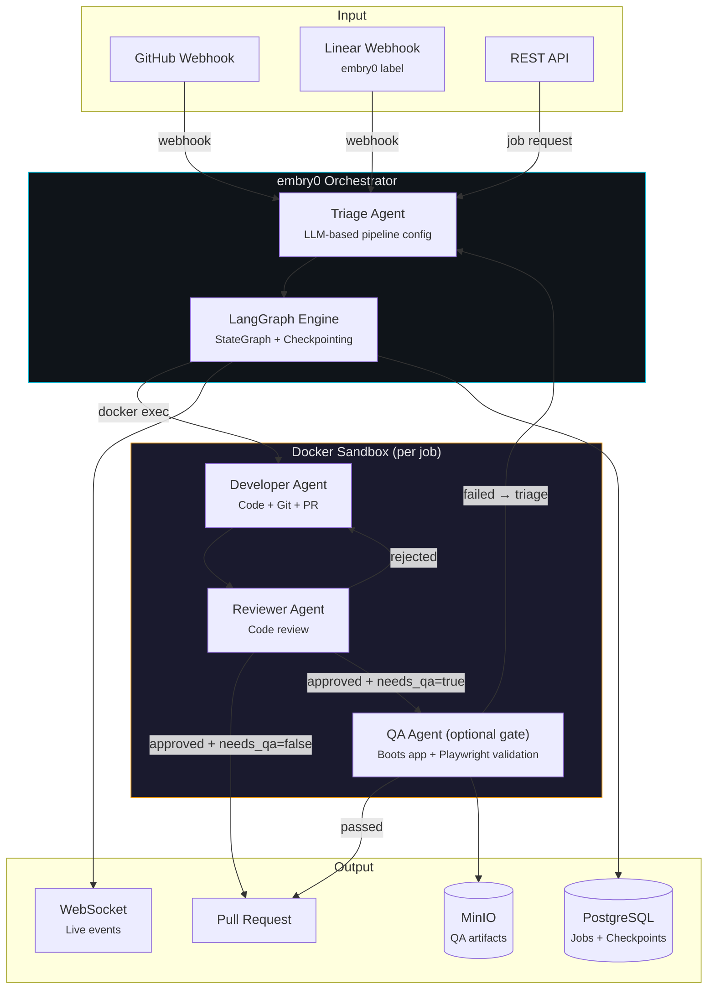

<div align="center">

# embry0

**Autonomous agent orchestration engine — GitHub issue in, reviewed pull request out.**

[](https://github.com/sudoTomas/embry0/actions/workflows/ci.yml)
[](https://python.org)
[](https://react.dev)
[](https://github.com/langchain-ai/langgraph)
[](LICENSE)

</div>

---

embry0 autonomously resolves GitHub issues by dispatching AI agents through a configurable pipeline: an LLM **triage agent** plans the work, a **developer agent** writes the code and opens the PR, a **reviewer agent** gates it, and an optional **QA agent** boots your full-stack app and validates acceptance criteria in a real browser. Built on **LangGraph** for orchestration and the **Claude Agent SDK** for execution, with every agent locked inside an isolated Docker sandbox.

**Where your code lives.** Agents work on a repository only inside its job's sandbox container, which is deleted when the job ends. Copies outlive it on the host: the job's event log and saved agent session in PostgreSQL (files the agent read and wrote, its shell commands) and pre-built QA images and per-repo cache volumes (a checkout). By default they are kept forever; `JOB_LOG_RETENTION_DAYS`, `AGENT_SESSION_RETENTION_DAYS` and `QA_IMAGE_RETENTION_DAYS` bound them, though not the registry's copies of QA images or database backups. [Data retention](SECURITY.md#data-retention) lists every copy and how long it stays.



## Features

- **Issue-to-PR pipeline** — triage scores confidence, splits oversized issues, and configures model tiers, validator modes, and sandbox profiles per job; the developer agent owns code, git, and PR creation; the reviewer loops it until approved.
- **Browser-verified QA gate** — boots your app's compose stack inside DinD and drives headless Chromium via Playwright against your acceptance criteria, with screenshots, console, network, and container logs as evidence.
- **The guild** — the home screen: your agents as characters in a guild hall, the work embry0 found as a quest board, every job a quest you send a party on, watch live and judge when it comes back (merge, send back with notes, reject, rate). See [docs/world.md](docs/world.md).
- **Specialist agents** — ten read-only built-ins that each return one report on a repository: a ledger of its cracks (kintsugi), one provable weed (gardener), a four-angle review (interrogator), why and how answers, a proven blast radius, a comment pass, a design audit, an audit of the instruction files that steer coding agents (context-auditor) and a map of a monorepo's areas (area-mapper). See [docs/specialist-agents.md](docs/specialist-agents.md).
- **Human-in-the-loop** — agents pause to ask questions, dispatched to the dashboard, Telegram, or a GitHub comment; the pipeline resumes when answered from any channel.
- **Issue tracker with GitHub two-way sync** — board and list views, webhook-triggered or manual dispatch.
- **Live dashboard** — React SPA streaming agent thinking, tool calls, costs, and QA evidence over WebSocket.
- **Budget controls** — per-job, daily, and monthly caps with soft/hard overrun modes.

## Security model

embry0 runs code an LLM agent writes, against repositories and issues you may not control. [SECURITY.md](SECURITY.md) is the threat model; the short version:

- **What holds.** Every job runs in its own container inside Docker-in-Docker, as a non-root user, with `--cap-drop=ALL` and `no-new-privileges`, which a sandbox profile cannot change. Forge tokens stay in credential proxies, and each sandbox has its own enrollment with them. Git reaches only the job's repository and pushes only from the issue-to-PR sandbox ([ADR 0007](docs/adr/0007-git-proxy-forwards-smart-http.md)); the forge API proxies forward only read calls on that repository. A sandbox cannot open a connection to another sandbox on the proxies' network, and its traffic to private, carrier-grade NAT and link-local addresses is dropped. Environment variables that would hook a sandbox's processes are reserved. The shared Docker daemon needs an admin's grant per repository, and embry0's own images run by digest.
- **What does not.** The agent's LLM credential (a Claude subscription token or an API key) is in the sandbox's environment, and public egress is open, so any code a job runs can read it and send it out ([ADR 0008](docs/adr/0008-llm-credential-in-sandbox-env.md)). The bash denylist (Ring 3) and the CLI's permission rules (Ring 2) are defence in depth, not boundaries. A repository granted Docker access is trusted code, root-equivalent on the host. An operator-tier key can run commands in a sandbox. By default the job log, saved agent sessions and pre-built QA images keep the repository's code with no end date ([Data retention](SECURITY.md#data-retention)). Details and the rest of the list: [What does not hold](SECURITY.md#what-does-not-hold).

Found a vulnerability? Report it privately, as [SECURITY.md](SECURITY.md#reporting-a-vulnerability) describes.

## Quick start

Requires Docker with the Compose plugin (`docker compose`) and Python 3.12+, on an x86_64 Linux host. The stack runs Docker-in-Docker in a privileged container. Its containers' memory limits total about 24 GB, each job's sandbox can take up to 8 GB more, and a first install, with its images and build cache, takes about 20 GB of disk.

```bash
git clone https://github.com/sudoTomas/embry0.git
cd embry0
cp .env.example .env
# Set in .env. Generate each secret with: openssl rand -hex 32
#   API_KEY, PROXY_ADMIN_TOKEN, ENVIRONMENT_SECRET_KEY, POSTGRES_PASSWORD, MINIO_ROOT_PASSWORD
#   GITHUB_TOKEN=ghp_...
# and one Claude credential:
#   CLAUDE_CODE_OAUTH_TOKEN=...   (the default auth mode, oauth; get one with `claude setup-token`)
#   or, for an API key: DEFAULT_AUTH_MODE=api_key and ANTHROPIC_API_KEY=sk-ant-...

python3 -m venv .venv && . .venv/bin/activate
pip install -e .          # installs the embry0 CLI
embry0 start              # builds every image, starts the stack, waits for health
```

Open the dashboard at **http://localhost:8200** and sign in with your `API_KEY`. Then create an issue and click **Send to Triage**. To trigger jobs straight from GitHub, set up [webhooks](docs/webhooks.md); the Cloudflare tunnel for them is an optional compose profile.

`embry0 start` reads this root `.env`, and `infra/.env` only for a `COMPOSE_FILE` overlay such as the [rootless sandbox runtime](docs/ops/provisioning.md#10-a-rootless-sandbox-daemon). Running compose yourself from `infra/` (as `infra/deploy.sh` does) reads `infra/.env` instead: start it from [`infra/.env.example`](infra/.env.example).

## Documentation

| Guide | What's inside |
|---|---|
| [Architecture](docs/architecture.md) | Full system reference — topology, pipelines, sandbox and proxy design, storage, job lifecycle |
| [Configuration](docs/configuration.md) | Environment variables, secrets at rest, execution/auth modes, CLI reference |
| [API reference](docs/api.md) | REST endpoints with curl examples, WebSocket event stream |
| [Onboarding a repo](docs/onboarding.md) | `embry0 init` (new projects) and `embry0 onboard` (existing repos) — zero-to-pipeline in one command |
| [Running QA](docs/running-qa.md) | Integrating a target repo, `qa.yaml`, gotchas, triggering and watching runs |
| [`qa.yaml` v2 reference](docs/qa-yaml-reference.md) | Field-by-field schema reference with monorepo examples |
| [Webhook setup](docs/webhooks.md) | Cloudflare Tunnel (production) and smee.io relay (local dev) |
| [Pull request review](docs/pr-review.md) | Advisory reviews posted on pull and merge requests: triggers, depth, forks, re-reviews |
| [Glossary](docs/glossary.md) | Domain vocabulary |
| [Decision records](docs/adr/) | ADRs — the decisions the codebase embodies and the evidence behind them |

## Development

```bash
uv sync --extra dev              # or: pip install -e ".[dev]"
uv run pytest tests/unit -q      # fast unit suite
uv run ruff check embry0 tests
cd frontend && npm install && npm test
```

Contributions welcome — see [CONTRIBUTING.md](CONTRIBUTING.md) for the workflow and commit conventions.

## Roadmap

Kubernetes deployment (Helm, DinD → pod launching) · user-defined LangGraph workflows via API · pipeline template marketplace · configurable per-agent Claude Code skills.

## License

[MIT](LICENSE) — use, modify, and distribute freely, including in proprietary and commercial software.

The project publishes no container images: you build them from this repository. They contain third-party software under its own terms, including the proprietary Claude Code CLI that the `claude-agent-sdk` wheel bundles. [THIRD_PARTY_NOTICES.md](THIRD_PARTY_NOTICES.md) lists it.

---

<div align="center">
  <sub>Built with LangGraph, Claude Agent SDK, FastAPI, React, and PostgreSQL</sub>
</div>
