# embry0 Architecture

Detailed technical documentation of the embry0 agent orchestration engine.

---

## System Overview

embry0 is a general-purpose agent orchestration engine built on LangGraph and Claude Agent SDK. GitHub issues or API requests create issues which are triaged by an LLM agent, questions are dispatched to the user via multiple channels (Dashboard, Telegram, GitHub, Linear), agents execute inside Docker sandboxes, and on success a PR is opened automatically. Agents work on customer code only inside ephemeral sandbox containers; the copies that outlive them (job events, saved agent sessions, pre-built QA images and per-repo volumes) and the settings that bound them are listed in [SECURITY.md](../SECURITY.md#data-retention).

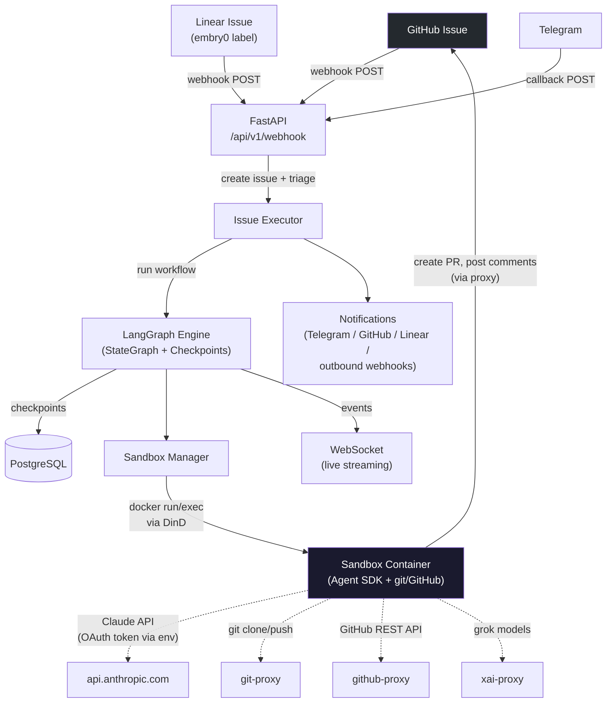

---

## Deployment Topology

One Docker Compose stack per tenant. No shared workspace volumes — sandbox containers clone repos internally and code is deleted on teardown.

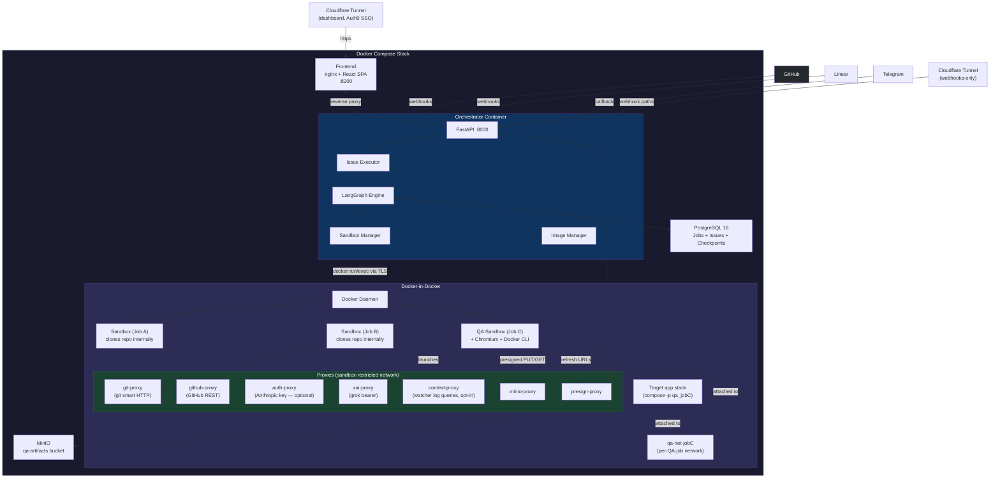

### Docker Network Segmentation

| Network | Services | Purpose |
|---------|----------|---------|
| `frontend` | Frontend, Orchestrator | Isolates frontend from database/DinD |
| `backend` | Orchestrator, PostgreSQL, DinD | Backend services only |
| `sandbox-restricted` | Proxy services, Sandbox containers | No internet (masquerade off), proxy-only access. A sandbox can open a connection to a proxy here and to no other sandbox: the `EMBRY0-SANDBOX-ISOLATION` chain (#554), described below. |
| `sandbox-internet` | Default `slim` profile and the other non-qa profiles, plus deployed-target QA, attached for the whole job. No per-step switch. | NAT egress so the Claude CLI can reach its API: `sandbox-restricted` has masquerade off and auth-proxy is not wired. Public egress stays open. The private-range drop (RFC1918, carrier-grade NAT, and link-local, except declared targets) is installed for every container on this network. |
| `qa-net-{job_id}__{app}` | One QA sub-task's sandbox + the target app's compose stack | Per-sub-task DinD network (DinD-mode apps only) created by `acquire_sandbox` and torn down by `cleanup_qa_resources` in `release_sandbox`. Lets the target app's services reach each other and the agent's browser backend (Playwright or Vibium) reach the frontend by short DNS names (`gateway`, `redis`, `frontend`). |

> **Networks are asserted at orchestrator startup, not auto-created.** The
> orchestrator inspects each network and refuses to start if `sandbox-restricted`
> lacks `enable_ip_masquerade=false`. The compose `init-sandbox-networks`
> one-shot service runs `infra/scripts/setup-sandbox-networks.sh` inside DinD
> as a prerequisite; the orchestrator depends on its successful completion.

#### Sandbox-to-sandbox isolation on `sandbox-restricted`

Docker leaves container-to-container traffic on for a bridge network, and
every sandbox joins `sandbox-restricted`, so without a rule one job's sandbox
could connect to whatever another job's sandbox listens on (a QA app's dev
server, a test database). `embry0/execution/runtime/isolation.py` installs one chain
in DinD's `DOCKER-USER` for the whole bridge, not rules per sandbox:

```
-A DOCKER-USER -i br-<id> -o br-<id> -j EMBRY0-SANDBOX-ISOLATION      (first rule)
-A EMBRY0-SANDBOX-ISOLATION -m conntrack --ctstate ESTABLISHED,RELATED -j RETURN
-A EMBRY0-SANDBOX-ISOLATION -d <each proxy's address>/32 -j RETURN
-A EMBRY0-SANDBOX-ISOLATION -m limit --limit 6/min -j LOG --log-prefix "embry0-isolation-block: "
-A EMBRY0-SANDBOX-ISOLATION -j DROP
```

- **When it is written.** At startup right after the proxies launch (their
  addresses change with every start), at the end of every `SandboxManager.create`
  for a sandbox on the network, after its egress rules so the jump stays above
  them, and when a paused sandbox is re-enrolled. Each write is one
  `iptables-restore` transaction that replaces the chain and moves the jump to
  the top.
- **Fail-closed.** The write refuses unless bridged traffic reaches iptables at
  all (`net.bridge.bridge-nf-call-iptables` is 1 in DinD's network namespace),
  the bridge interface exists, `FORWARD` jumps to `DOCKER-USER`, and the jump and
  the final DROP are evaluated after the write. It also refuses a chain that
  would allow no proxy. A sandbox whose create cannot write it is destroyed; a
  resume that cannot write it leaves the job paused; at startup it is logged as
  `sandbox_isolation_unavailable`.
- **Nothing per sandbox.** No rule names a sandbox's address, so there is
  nothing to remove when a sandbox ends and nothing for a crash to leak.
- **Untouched.** Traffic to the bridge gateway (DinD itself, how a
  `dind_enabled` sandbox reaches the daemon) is INPUT, not FORWARD.
  `sandbox-internet` keeps its own private-range drop (below), and traffic
  between bridges (`qa-net-{job_id}` to anything else) is dropped by Docker's
  own isolation chains.
- **Blocked attempts** are counted on the chain's DROP rule:
  `docker exec <dind> iptables -L EMBRY0-SANDBOX-ISOLATION -v -n`. The
  rate-limited `LOG` rule (prefix `embry0-isolation-block:`) reaches the kernel
  log only when the host sets `net.netfilter.nf_log_all_netns=1`, because DinD
  has its own network namespace.

#### The private-range drop on `sandbox-internet`

`embry0/execution/runtime/egress.py` gives every sandbox on `sandbox-internet`
a short block in `DOCKER-USER`, keyed on its address there, and one chain
shared by every sandbox holds the drop and the proxy exceptions:

```
-A DOCKER-USER -s <sandbox>/32 -d <declared target>/32 -j RETURN   (each, from the profile)
-A DOCKER-USER -s <sandbox>/32 -j EMBRY0-SANDBOX-EGRESS
-A EMBRY0-SANDBOX-EGRESS -m conntrack --ctstate ESTABLISHED,RELATED -j RETURN
-A EMBRY0-SANDBOX-EGRESS -d <each proxy's sandbox-internet address>/32 -j RETURN
-A EMBRY0-SANDBOX-EGRESS -d <private range> -m limit --limit 6/min -j LOG --log-prefix "embry0-egress-block: "
-A EMBRY0-SANDBOX-EGRESS -d <private range> -j DROP   (each of RFC1918, CGN, link-local)
```

- **Why the proxies are in the shared chain (#568).** The proxies are recreated
  at every start, and Docker may give them new addresses and give their old
  ones to new sandboxes. Per-sandbox proxy exceptions would follow neither for a
  sandbox that outlives the restart. The chain is rewritten from the running
  proxies, in one `iptables-restore` transaction, at startup, at every
  `SandboxManager.create` for a sandbox on the network, and when a paused
  sandbox is re-enrolled. The same refresh converts the rules of a sandbox
  created before the chain existed: its RETURNs outside the network's subnet
  (its declared targets) are kept, the rest is replaced by the jump.
- **Fail-closed.** An empty chain would allow everything, so a jump to it is
  written only after the chain is checked to end in its last DROP. A sandbox
  whose create cannot write its rules is destroyed; a resume that cannot leaves
  the job paused.
- **Blocked attempts** are counted on the chain's DROP rules:
  `docker exec <dind> iptables -L EMBRY0-SANDBOX-EGRESS -v -n`. The `LOG` line
  reaches the kernel log only with `net.netfilter.nf_log_all_netns=1` on the
  host (#567).

#### The same networks on the rootless runtime

With `AGENT_RUNTIME=rootless` (#268) the networks, both chains and the proxies
live on a dedicated rootless Docker daemon instead of DinD, in rootlesskit's
network namespace, and are written by the same helper container on
`--network host`. What differs:

- **The bridge gateway** is rootlesskit's namespace, where nothing listens: the
  daemon serves only its unix socket, and no sandbox is ever given the daemon
  (`dind_enabled` profiles and QA `mode: dind` are refused). Anything that did
  listen there would be reachable from every sandbox, which is why the daemon
  never gets a TCP socket.
- **Outbound traffic** leaves through slirp4netns, which opens each connection
  as the daemon's account; the private-range drop applies before it, and host
  loopback is off. `sandbox-restricted` has no masquerade, so it still leads
  nowhere.
- **The rules are counted** with
  `DOCKER_HOST=unix:///run/embry0-sandbox/docker.sock docker run --rm --network host --cap-add NET_ADMIN --entrypoint iptables embry0-egress-helper:latest -L EMBRY0-SANDBOX-ISOLATION -v -n`.

The full mapping of each DinD mechanism is in
[provisioning.md §10](ops/provisioning.md#10-a-rootless-sandbox-daemon).

### Services

| Service | Image | Purpose | Resources |
|---------|-------|---------|-----------|
| Frontend | `embry0-frontend` | nginx serving React SPA, reverse proxy | — |
| Orchestrator | `embry0-orchestrator` | FastAPI + LangGraph, job management, proxy services. Never checks out customer code; stores job events and agent sessions, which carry it ([Data retention](../SECURITY.md#data-retention)). | configurable via `.env` |
| PostgreSQL | `postgres:16` | Application data + LangGraph checkpoints | configurable via `.env` |
| DinD | `docker:dind` | Runs sandbox containers (privileged) | configurable via `.env` |
| MinIO | `pgsty/silo` (Silo, the community fork of MinIO) | S3-compatible artifact store. `qa-artifacts` bucket holds QA `result.json`, screenshots, traces, and `logs/full.log` per `<job_id>/<attempt_n>/...`. | configurable via `.env` |

No shared workspace volumes. All resource limits, ports, image tags, and credentials are configurable via `.env` file.

Beyond these five core services, the compose file defines 19 services in total: supporting long-running services (`postgres-backup` for daily dumps, an in-stack `registry` sidecar that DinD pulls sandbox images from, the hosted MCP endpoint `mcp`, the `cloudflared` webhooks-only tunnel, and the `cloudflared-dashboard` tunnel that fronts the SSO-gated public dashboard), four one-shot init services (`registry-auth-init`, which generates the registry's login; `init-sandbox-networks`; `init-push-images`, which pushes the sandbox and proxy images and records the digest each one runs by; and `cloudflared-dashboard-config`, which renders the dashboard tunnel's ingress), and five image builders behind the `images` profile (`sandbox`, `dev-python`, `dev-jvm-python`, `qa`, `proxy`).

---

## Issues & Human-in-the-Loop

Issues are first-class entities in embry0 — independent of jobs. An issue is the **what** (the problem/request), a job is the **how** (the execution). Issues support optional two-way GitHub sync and can be decomposed into child issues by the triage agent.

### Issue Lifecycle

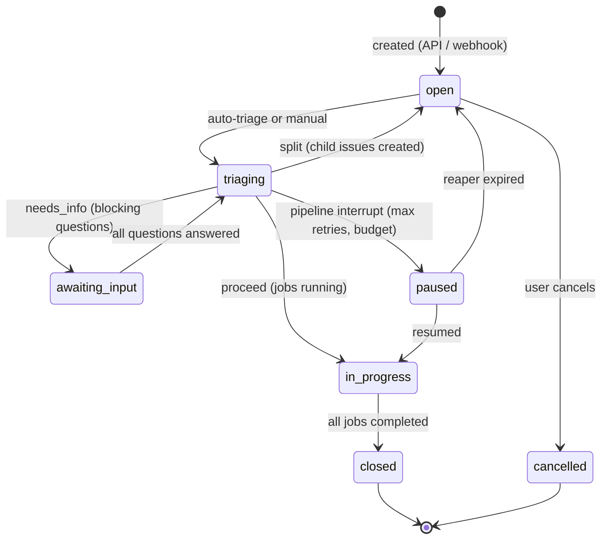

A question pauses the pipeline for **as long as the answer takes** — `awaiting_input` has no TTL (RAV-1059); the answer can be anything, including redirecting the agent. Only `paused` issues (pipeline interrupts such as max-retries or budget overrun) expire: when the paused job passes `paused_job_ttl_hours`, the `ContainerReaper` expires the job, destroys its sandbox, and reopens the issue (`paused` → `open`). Resumption always rebuilds the sandbox.

### Multi-Channel Notifications

When the pipeline needs human input (`interrupt()`), questions are dispatched to three channels simultaneously:

| Channel | Mechanism | Answer Matching |
|---------|-----------|----------------|
| **Dashboard** | Questions panel on issue detail page | `POST /api/v1/issues/{id}/inputs/{input_id}/answer` |
| **Telegram** | Per-question message with inline buttons | Reply-to-message matching via `telegram_message_id` |
| **GitHub** | Comment on linked GitHub issue | `issue_comment.created` webhook — `/answer <input_id>:` (the id is printed under each question; `/answer <n>:` is sugar for one comment's numbering and is refused when two comments have questions outstanding), collaborators only (#253) |
| **Linear** | Question + Q&A decision-trail comments on the linked Linear issue (RAV-1076) | Read-only trail — answer via any other channel |
| **Outbound webhooks** | HMAC-signed POSTs for job/watcher/question events (RAV-1052) | Consumer-defined (the operator's own client) |

Answers from any channel trigger cross-channel sync (e.g., answer via Telegram → edit GitHub comment). When all blocking questions are answered, the pipeline resumes automatically.

**Delivery retries (#252).** A question that never reaches its channel leaves the job in `awaiting_input` with nothing for the operator to answer, so every outbound send shares one retry policy (`embry0/notifications/retry.py`): three attempts, exponential backoff from one second, and an advertised `Retry-After` — delta-seconds or HTTP-date — honoured on every transient response, 5xx included. Advertised and computed delays share one 30s ceiling, and a `Retry-After: 0` reads as "no delay advertised" rather than "retry now". A 429, any 5xx and a dropped connection are transient and buy another attempt, as does a 4xx that advertises a rate limit via `Retry-After` or `x-ratelimit-remaining: 0` (GitHub signals its secondary rate limit as a 403) and a Telegram reply of any status carrying `parameters.retry_after` flood control, whose window the plain backoff curve would sit inside. Every other 4xx is permanent and stops immediately, because a rejected token or a malformed payload fails identically next time. Each retry logs `notification_retry`, and every lost notification logs exactly one `notification_failed` — `permanent=true` when the first attempt was rejected outright, `false` when the budget ran out — so an alert keyed on that single event misses no drop. Both carry the channel name and attempt count. Telegram swallows an exhausted send (`send_message` keeps returning `None`, which callers already read as "not delivered"); the GitHub comment channel re-raises, and `dispatch_to_channels` isolates that per channel so one dead surface can't block the others. The signed outbound webhook keeps its own pre-existing rule of retrying every non-2xx, its consumer contract being consumer-defined; moving it onto the shared helper did change two observable things, though — it now honours `Retry-After`, and its `webhook_attempt_failed` log event is gone, replaced by `notification_retry` / `notification_failed`.

### GitHub Two-Way Sync

- **Outbound (embry0 → GitHub):** Issue create/update pushes to GitHub API
- **Inbound (GitHub → embry0):** Webhook handles `issues.opened`, `issues.edited`, `issues.closed`, `issues.reopened`, `issues.labeled`, `issues.unlabeled`, `issue_comment.created`
- **Which inbound events dispatch a job:** only `issues.opened` and `issues.labeled`, and only when the label set intersects `TRIGGER_LABELS`. The rest are state sync. `issues.labeled` dispatches on the *transition* into the labelled state — re-delivery, or an unrelated label added to an already-labelled issue, does not re-fire. An issue embry0 has never seen is adopted on its first trigger label. Dispatch requires the issue to be `open`, so an issue with a job already running is synced but not re-dispatched, and a closed issue is not resurrected by a label.
- **Conflict handling:** Last-write-wins with timestamps

---

## Request Lifecycle

End-to-end flow from issue creation to PR:

```mermaid
sequenceDiagram
    participant C as Client / GitHub
    participant API as FastAPI
    participant EX as Issue Executor
    participant LG as LangGraph (astream)
    participant SM as Sandbox Manager
    participant SB as Sandbox
    participant SDK as Agent SDK
    participant NT as Notifications

    C->>API: POST /api/v1/issues (or webhook)
    API->>API: Create issue, GitHub sync
    API->>EX: execute(issue_id) — auto-triage

    EX->>EX: Create job, link to issue
    Note over EX: PR dedup (RAV-1079) — if an open PR already<br/>matches the issue, skip + link it (zero agent spend);<br/>if a failed job of this issue left it, continue on it (#349)
    EX->>SM: create sandbox container
    SM->>SB: docker run (DinD)
    Note over SB: Clone repo via Git Proxy

    EX->>LG: graph.astream(initial_state)

    loop For each node (triage → developer → review)
        LG->>SM: run_agent(container_id, config)
        SM->>SB: docker exec → runner.py
        SB->>SDK: query(prompt, tools, model)
        SDK->>SDK: Tool calls (Read/Write/Bash)
        SB-->>SM: JSON lines (stdout)
        SM-->>LG: AgentOutput → state update
        LG-->>EX: StreamWriter events (custom)
        EX-->>C: WebSocket events (live)
    end

    alt Triage needs info
        LG->>LG: interrupt(questions)
        EX->>EX: Create issue_inputs records
        EX->>NT: Dispatch to Telegram + GitHub + Dashboard
        NT-->>C: Questions via all channels
        C->>API: Answer (any channel)
        API->>EX: resume — Command(resume=answers)
        EX->>LG: Continue from checkpoint
    end

    alt Review approved
        Note over SB: Developer already created PR
        SB-->>LG: pr_url in state
    else Review rejected (retry ≤ 3)
        LG->>LG: Inject feedback, retry developer
    else Max retries reached
        LG->>LG: interrupt(options) — ask user
    end

    EX->>SM: destroy sandbox (code deleted)
    EX->>API: Update job (pr_url, cost, status)
    API-->>C: Job result
```

---

## Issue-to-PR Pipeline

The built-in workflow. The triage node uses an LLM to assess complexity, configure the pipeline, and determine if more information is needed or the issue should be split.

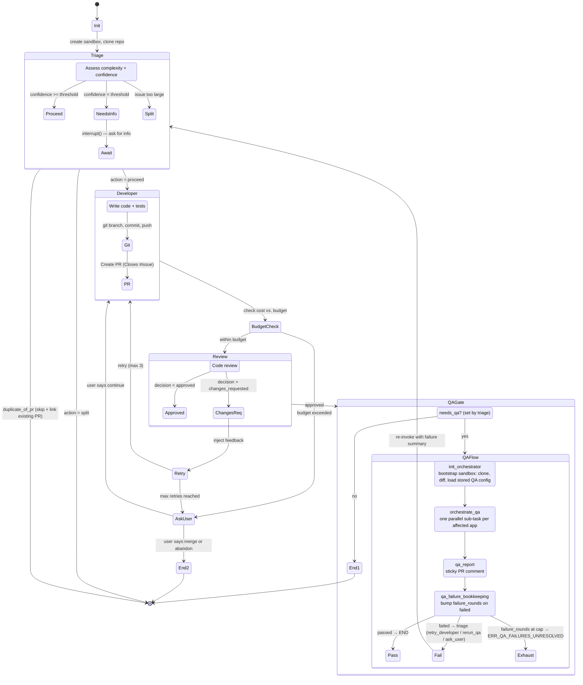

> **Note on `split`:** The `split` action creates child issues as a side effect inside `run_triage_node` (calling the embry0 API proxy) and then terminates the current workflow; there is no dedicated child-creation node in the graph.

> **Note on verification tiers (#298/#299):** `needs_qa` is triage's request, not the last word. After an approved review the `verify` node runs the deterministic test gate and prunes the QA step for backend-only diffs and for repos whose QA config has no branch-booted (`target: managed`) app; a branch job never QAs a `target: deployed` app. Details: `docs/verification.md`.

> **Note on QA gate:** Triage emits `set_qa_decision` (initial pass) and `qa_failure_action` (after a failed QA run) inline in its JSON output. The QA subpath reuses the standalone QA workflow's nodes (`orchestrate_qa` in its branch variant, which never QAs a `target: deployed` app) — see the QA Pipeline section below for the inner workings.

### Graph Nodes

| Node | Agent? | Tools | Purpose |
|------|--------|-------|---------|
| `init` | No | — | Create sandbox container, clone repo |
| `triage` | Yes | Read, Glob, Grep | Analyze issue, configure pipeline. Can `interrupt()` for questions. Also emits `set_qa_decision` (whether QA gate runs), `duplicate_of_pr` (skip + link when an open PR already covers the issue, RAV-1079) and, on re-invocation after QA failure, `qa_failure_action` (retry_developer / rerun_qa / ask_user). |
| `developer` | Yes | Read, Write, Edit, Bash, Glob, Grep | Write code, create branch, commit, push, open PR |
| `review` | Yes | Read, Bash, Glob, Grep | Code review with structured JSON output. Can request changes (triggers retry). |
| `verify` | No | — | After an approved review (#298/#299): classify the diff into a verification tier, run the repo's configured test commands on base and head in the dev sandbox, store the result (`job_verifications`). New test failures end the job (`ERR_VERIFY_NEW_TEST_FAILURES`); otherwise the route plan continues, with the QA step pruned unless the change is frontend-touching and the repo's QA config can boot the app from the branch. See `docs/verification.md`. |
| `retry` | No | — | Inject review feedback into state, increment counter |
| `max_retries` | No | — | `interrupt()` — ask user: continue, merge as-is, or abandon |
| `init_orchestrator` | No | — | (QA gate, when `needs_qa=true`) In a short-lived `slim` bootstrap sandbox: clone, compute the diff, load the stored `repo_qa_configs` document into `state["qa"]` |
| `orchestrate_qa` | Yes (per app) | The QA agent: Read, Glob, Grep, Bash, Edit, plus the selected browser backend's MCP tools (Playwright: 23, Vibium: 49 — see `workflows/qa/browser_backends.py`) | Fan out one sub-task per affected app (the sub-task graph, see QA Pipeline), aggregate the results, set `qa.final_status` |
| `qa_report` | No | — | Write the sticky QA PR comment with the aggregate verdict and per-app breakdown |
| `qa_failure_bookkeeping` | No | — | Increment `qa.failure_rounds` when `final_status=failed` |
| `qa_exhausted` | No | — | Terminal node when `failure_rounds` hits the cap; sets `error_code=ERR_QA_FAILURES_UNRESOLVED` |

### Triage Decision

The LLM triage node outputs a pipeline configuration.

| Field | Type | Purpose |
|-------|------|---------|
| `action` | `proceed \| needs_info \| split` | What to do next |
| `confidence` | `float (0.0-1.0)` | Confidence in implementation approach |
| `pipeline_template` | `str` | Template name or "custom" |
| `pipeline_config.sandbox_profile` | `str` | Sandbox profile name |
| `pipeline_config.agent_models` | `dict[str, str]` | Model per agent |
| `pipeline_config.agent_tools` | `dict[str, list[str]]` | Per-agent tool allowlist overrides |
| `pipeline_config.agent_skills` | `dict[str, list[str] \| {"add", "remove"}]` | Per-agent Claude Code skills: a delta (`add`, `remove` or `"*"`) over the agent's configured skills, or a bare list that replaces them |
| `pipeline_config.max_feedback_loops` | `int` | Review → retry cycles (default: 3) |
| `pipeline_config.reviewer_enabled` | `bool` | Whether review is included (default: true) |
| `pipeline_config.validator_modes` | `list[str]` | Which validators to run (test, lint, typecheck) |
| `pipeline_config.budget_usd` | `float` | Suggested budget for this job |
| `questions` | `list[dict]` | When `needs_info`: `{question, importance, suggested_answer}` |
| `sub_tasks` | `list[dict]` | When `split`: `{task, description}` objects |
| `reasoning` | `str` | Why this configuration was chosen |

**Per-repo preference override (Plan K).** If a row exists in `repo_preferences` for the current `owner/repo`, its `sandbox_profile` value **overrides** whatever the triage LLM chose in `pipeline_config.sandbox_profile`. The override is applied after triage parsing and before graph execution; the LLM is still free to reason about profiles, but the repo preference wins at execution time. See the ER diagram for the `repo_preferences` table.

### LangGraph Native Patterns

| Pattern | Usage |
|---------|-------|
| `interrupt(value)` | Pause graph for human input (triage questions, max retries) |
| `Command(resume=value)` | Resume paused graph with user's answer |
| `get_stream_writer()` | Nodes emit custom events (progress, tool calls, PR created) |
| `graph.astream(stream_mode=["updates", "custom"])` | Executor captures live events |
| `config["configurable"]` | Dependency injection: AgentRunner, SandboxManager, proxy URLs |

---

## QA Pipeline

The QA agent boots a target full-stack application inside DinD, drives a headless browser via the repo's selected browser backend (Playwright MCP by default; Vibium MCP via `browser_backend: vibium` — see docs/qa-yaml-reference.md), and validates each acceptance criterion with screenshots, browser console, network activity, and per-service container logs as evidence. Two modes:

- **Standalone** (`POST /api/v1/jobs` with `pipeline=qa`) — run QA against any branch on demand. Used for ad-hoc validation and CI smoke. Graph: `embry0/workflows/qa/graph.py`.
- **PR-gated** (issue→PR with `needs_qa=true`) — triage decides whether the resulting PR should be QA-validated; the issue→PR graph routes through `init_orchestrator → orchestrate_qa → qa_report → qa_failure_bookkeeping` after `review`/`verify` and re-invokes triage on failure with the failure summary so it can pick `retry_developer` / `rerun_qa` / `ask_user`.

Both modes run the same three top-level nodes:

| Node | Module | Does |
|------|--------|------|
| `init_orchestrator` | `workflows/qa/orchestrator.py` | Allocates a short-lived `slim` bootstrap sandbox, clones the repo for the diff and workspace staging, loads the repo's stored QA config (qa.yaml v2) from the DB, destroys the sandbox |
| `orchestrate_qa` | `workflows/qa/orchestrator.py` | Resolves which apps the change affects and runs one **sub-task** per app in parallel; aggregates the `SubTaskResult`s into `qa.per_app_results` and `qa.final_status`, persists them (`qa_app_results`) and publishes the `done` event the dashboard's SSE stream closes on |
| `qa_report` | `workflows/qa/orchestrator_report.py` | Upserts the sticky PR comment (the only QA reporting surface) |

Each sub-task is a linear subgraph (`workflows/qa/subtask_graph.py`). Every node short-circuits once an earlier one has set the sub-task's `status`, so `release_sandbox` and `emit_result` always run. The sub-task's job id is `<run_id>__<app>`.

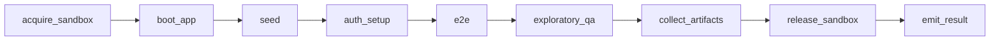

| Sub-task node | Does |
|---------------|------|
| `acquire_sandbox` | Picks the sandbox image (a pre-baked QA image or warm volume when available), creates `qa-net-<run_id>__<app>` for DinD-mode apps, creates the sandbox, clones via git-proxy (`prep_qa_sandbox_clone`), registers the sandbox token and writes `/workspace/.qa/job.json` with presigned PUT URLs (`prep_qa_sandbox_jobjson`) |
| `boot_app` | Runs the app's `boot_command` and `ready_checks` (`run_boot_phase`); on failure uploads a diagnostic screenshot and sets `BOOT_FAILURE` / `READY_CHECK_FAILED` |
| `seed` | Optional data seeding |
| `auth_setup` | Optional: writes `/workspace/.qa/storage-state.json` for pre-authenticated QA from a secret or a login command |
| `e2e` | Optional repo e2e suite, before exploratory QA |
| `exploratory_qa` | Runs the QA agent (`qa_node` in `workflows/qa/nodes.py`) through its browser backend's MCP tools; it validates each acceptance criterion and writes `result.json` |
| `collect_artifacts` | Reads and Pydantic-validates `/workspace/.qa/result.json`, adds the boot section, maps the verdict to a `SubTaskStatus` |
| `release_sandbox` | Destroys the sandbox, unregisters its token, runs `cleanup_qa_resources` (containers, volumes and network by label) |
| `emit_result` | Builds the `SubTaskResult` and publishes a `subtask_status` event for the dashboard's SSE stream |

Sub-task statuses: `passed`, `qa_failure`, `e2e_failure`, `boot_failure`, `ready_check_failed`, `infra_failure`, `inconclusive`, `skipped`. There are no automatic QA retries: a failed run in the PR-gated mode goes back to triage (below).

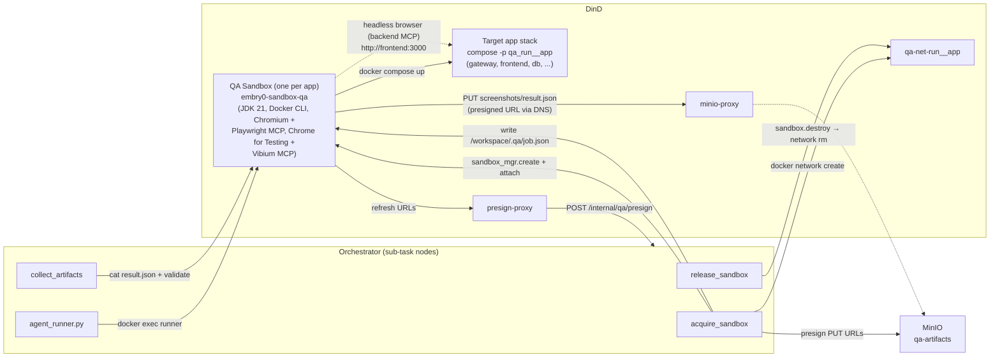

### Per-sub-task lifecycle

| Step | Owner | Action |
|------|-------|--------|
| 1. network | `acquire_sandbox` | `docker network create qa-net-<run_id>__<app>` (DinD-mode apps) |
| 2. sandbox | `acquire_sandbox` | Create the QA sandbox container, attach to qa-net + sandbox-restricted |
| 3. clone | `acquire_sandbox` | Clone the branch from inside the sandbox via git-proxy (skipped when a warm volume is mounted) |
| 4. presign + job.json | `acquire_sandbox` | Register the sandbox token, mint presigned PUT URLs (`result.json`, `logs/full.log`) against the **sandbox-facing** endpoint (`minio-proxy:9100`), write `/workspace/.qa/job.json` |
| 5. boot | `boot_app` | Start the app and wait for its ready checks |
| 6. agent | `exploratory_qa` | `python -m embry0.sandbox.runner` invokes the QA agent, which uploads artifacts via curl |
| 7. parse | `collect_artifacts` | `cat /workspace/.qa/result.json` → `QAResult` validation → `SubTaskStatus` |
| 8. teardown | `release_sandbox` | sandbox destroy → token unregister → `cleanup_qa_resources`. Order matters — the sandbox must die before `network rm` or it stays attached. |

### Two MinIO clients

Phase 1.5 architecture decision: presigned URLs are signed against whichever endpoint the *requester* will use to hit MinIO. The orchestrator and the sandbox live on different networks (host-side `backend` vs DinD-side `sandbox-restricted`), so two `QAMinioClient` instances are wired into `app.state`:

| Client | Endpoint | Used by |
|--------|----------|---------|
| `qa_minio` | `minio:9000` (host backend network) | Orchestrator-side reads (`/jobs/{id}/qa/attempts/{n}/result` GET) |
| `qa_minio_sandbox` | `minio-proxy:9100` (DinD sandbox-restricted) | `acquire_sandbox_node` mints PUT URLs the sandbox will follow |

`minio-proxy` and `presign-proxy` are containers running inside DinD on `sandbox-restricted` (paired with the `git-proxy` family). `minio-proxy` is a thin reverse proxy onto the host MinIO; `presign-proxy` forwards `POST /api/v1/internal/qa/presign` calls to the orchestrator so the agent can mint additional URLs at runtime (screenshots, traces).

### `result.json` contract

The agent writes a Pydantic-validated JSON file at end of run. Top-level shape:

```python
class QAResult:
    schema_version: Literal[1]
    job_id: str
    attempt_n: int
    phase_reached: Literal["boot", "seed", "e2e", "exploratory", "report"]
    overall: Literal["passed", "failed", "inconclusive"]
    boot: QABootResult                                   # command, duration_ms, ready_checks
    seed: QASeedResult | None
    e2e: QAE2EResult | None
    acceptance_results: list[QAAcceptanceResult]         # criterion, status, evidence, console_errors, network_failures, log_excerpts
    anomalies: list[QAAnomaly]                           # console_error | network_error | unexpected_state | crash
```

When the agent ran but `result.json` is missing, malformed or fails validation, `collect_artifacts` synthesizes an `inconclusive` result for every criterion (an `infra_failure` when the agent never ran); the runtime prompt sent to the agent includes the schema verbatim to keep field shapes correct.

### Triage QA decision (PR-gated mode)

Triage emits two distinct decisions inline in its JSON output (parsed via `TriageDecisionModel`):

| Field | When | Shape |
|-------|------|-------|
| `set_qa_decision` | Initial pass | `{needs_qa, reason, acceptance_criteria}` |
| `qa_failure_action` | Re-invocation after `qa.final_status=failed` | `{kind: retry_developer\|rerun_qa\|ask_user, ...action-specific}` |

`route_after_qa_report` consumes `qa.final_status` + `qa.failure_rounds`:
- `passed` → END
- `exhausted` → END
- `failed` and `failure_rounds < max_qa_failure_rounds` (default 2) → `triage` (with failure context)
- `failed` and at cap → `qa_exhausted` → END with `ERR_QA_FAILURES_UNRESOLVED`

---

## Sandbox Container Architecture

Each job gets one Docker sandbox inside DinD. The sandbox clones the repo, agents execute inside it, and all git/GitHub operations happen within. When destroyed, its checkout is deleted; [Data retention](../SECURITY.md#data-retention) lists what outlives it.

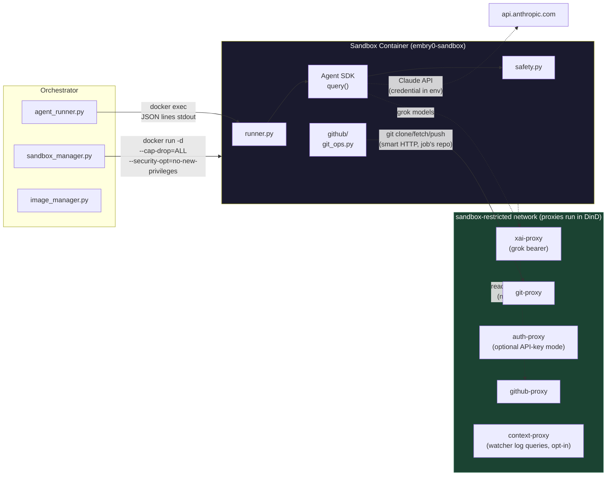

### Container Security

| Control | Implementation |
|---------|---------------|
| Capability drop | `--cap-drop=ALL`, nothing added back. Not configurable: a sandbox profile's `cap_drop` must include `ALL` and its `cap_add` must be empty (#553) |
| Privilege escalation | `--security-opt=no-new-privileges`, Docker's default seccomp and AppArmor. A profile's `security_opt` may hold only `no-new-privileges` (#553) |
| Resource limits | `--memory`, `--cpus`, `--pids-limit` (all configurable) |
| Filesystem | Writable root (read-only disabled — Claude CLI requires writable fs), so `/tmp` and `/workspace` are on it; the `/tmp` tmpfs is mounted only for a read-only root |
| Network | `sandbox-restricted`, plus `sandbox-internet` (NAT egress with the private-range drop, see [Docker Network Segmentation](#docker-network-segmentation)) for the whole job when the profile lists it, as every builtin profile except `qa-jvm` does. A profile's `extra_networks` may name no other network (#553) |
| Image | A profile's `base_image` names an image in embry0's own registry, without a registry host; it is pulled by its digest pin when one is installed (#523, #553) |
| Credentials | Forge tokens are injected by the proxies (see Proxy Services) and never enter the sandbox. **The LLM credential does:** `CLAUDE_CODE_OAUTH_TOKEN` or `ANTHROPIC_API_KEY`, and `XAI_API_KEY`, are in the sandbox env, because the Claude CLI reads its credential from there and subscription OAuth stays supported ([ADR 0008](adr/0008-llm-credential-in-sandbox-env.md)). Any code in the sandbox can read them. Only the xAI subscription token stays in `xai-proxy`. |
| Command blocking | Ring 3: 41 regex patterns on Bash commands (`embry0/safety/patterns.py`), after NFKC normalization. Ring 2: the CLI's permission rules; embry0's own copy of that check, for the direct xAI executor, normalizes paths lexically and does not resolve symlinks. Defence in depth: neither binds a program the agent writes and runs |
| Code retention | The checkout is deleted with the container. Job events, saved agent sessions, pre-built QA images and per-repo volumes keep copies until `JOB_LOG_RETENTION_DAYS`, `AGENT_SESSION_RETENTION_DAYS` and `QA_IMAGE_RETENTION_DAYS` remove them; all three are unset by default ([Data retention](../SECURITY.md#data-retention)) |
| LLM credentials | Resolved by the credential registry for each job and passed to the sandbox env (see the Credentials row above) |
| Ring-3 enforcement | Asserted where the hook runs: the sandbox image builds fail, and `SdkAgentExecutor.run` returns an error before `query()`, if the sandbox's `claude_agent_sdk` does not declare `hooks` or the `PreToolUse` event (`embry0/agents/sdk_support.py`, #497). The orchestrator never runs an agent, so it no longer checks its own SDK. Per-run hook attachment is unconditional — no fall-back. The in-process executor fallback was removed in 2026-04 hardening. |

**Sandbox env surface:** The container env holds the LLM credential (see the Credentials row above), the global and repository environment variables, secrets included, and orchestrator config such as `EMBRY0_GIT_PROXY_URL`. No forge token. The per-sandbox proxy bearer is in files (git's config, the xAI and context-proxy token files), not the env. See [`SECURITY.md`](../SECURITY.md#what-does-not-hold) for what that exposes.

### Skills store and mounts

Skills reach a sandbox as Agent SDK plugins from a store the orchestrator fills ([API](api.md#skills)). The store is the `skills-store` compose volume, mounted at `/skills` in `orchestrator` (read-write) and in `dind` (`:ro`), because the bind mounts below are resolved in the sandbox daemon's namespace. Each source has `/skills/<source_id>/<resolved_sha>/`, a plugin root (`.claude-plugin/plugin.json`, `skills/<name>/SKILL.md`), and `/skills/<source_id>/current`, one line naming the tree sandboxes mount. A sync fills a staging directory beside the tree, renames it into place and rewrites `current`; a failed sync leaves the previous tree and `current` as they were. A sync requested while one of the same source runs is coalesced, not dropped: the running sync runs once more when it finishes, reading the row afresh, so the newest ref or inline content is what ends up published. Older trees stay while a sandbox may mount them: after each publish and at startup, `SandboxManager.gc_skill_trees` reads the mount sources of every container on the sandbox daemon (`docker ps -aq`, then one `docker inspect`), adds the trees of any create still inside `docker run`, and removes only the stale trees outside that set; when the daemon cannot be listed it removes nothing. `SKILLS_STORE_PATH` (default `/skills`) is the orchestrator's path and `SKILLS_STORE_DAEMON_PATH` (default: the same) the daemon's, which under the rootless overlay is the host directory that daemon sees ([configuration](configuration.md)).

**Mounts.** Every sandbox gets `-v /skills/<id>/<sha>:/opt/embry0/skills/<id>:ro` for each enabled source whose `current` tree exists, read at create time; `status` is informational, so a source whose latest re-sync failed keeps its previous tree mounted. A source with no tree on disk is skipped with `skill_source_mount_missing` rather than failing `docker run`, and startup re-syncs every enabled source whose `current` is missing, retrying the ones still missing after 60 s, 300 s and 900 s and then leaving them to an admin. A source that becomes ready after a sandbox was created is not visible to that job. `agent_started` events carry `skill_sources: [<source ids>]`, the sources that sandbox mounted; after an orchestrator restart they are read from the container's own mounts (`docker inspect`), and the current manifest stands in only when that inspect fails (`skill_mounts_inspect_failed`).

**SDK options.** `build_sdk_options` passes `plugins=[{"type": "local", "path": "/opt/embry0/skills/<id>"}]` for each mounted source whose plugin name prefixes at least one skill in the agent's effective list (`<plugin>:<skill>`; a bare name is one of the repository's own skills and selects no plugin), and `skills=<effective list>` as the allowlist. With an empty list it passes no plugins and `skills=None`, so only the target repository's own `.claude/skills` load, unfiltered. A mounted plugin's hooks run for the agents that list its skills, which is how the plugin behaves in Claude Code too. `setting_sources` stays `["project"]`. `embry0/agents/config_builder.py`, `embry0/agents/invocation.py` and `embry0/sandbox/runner.py` are baked into the sandbox images, so the sandbox images must be rebuilt ([recipe](ops/deploy.md#images-registry-pins-and-rebuilds)) before these options take effect; until then the trees are mounted and unused. The direct xAI executor does not load skills.

**What the orchestrator runs.** A git source is the one place the orchestrator runs git itself, on a public tree an admin pinned. It runs with hooks (`core.hooksPath=/dev/null`), every transport but https (`protocol.allow=never`), redirects, submodules, fsmonitor, and system and global config disabled, no terminal prompt, a throwaway `HOME`, and a 120 s timeout that kills git's whole process group. Before cloning it resolves the url's host and refuses it unless every address is global and not multicast. git is then pinned to the addresses that were checked (`-c http.curloptResolve=<host>:<port>:<address>[,<address>]`), so it never connects to a second DNS answer (rebinding). The checked-out tree loses its `.git`, must stay under 64 MiB and carry at least one `skills/*/SKILL.md`, and a symlink anywhere in it fails the sync. Skill names must match `^[a-z0-9][a-z0-9._-]{0,63}$` and the plugin name `^[a-z0-9][a-z0-9_-]{0,63}$` (the SDK refuses a colon, comma, parenthesis or whitespace), and a plugin name another source already uses as its id or plugin name fails the sync. A `path` source must resolve inside `SKILLS_PATH_ROOT` ([configuration](configuration.md)); with that unset every `path` source is refused. It is copied with links kept as links, so the same check refuses them, and regular files only (a FIFO, device or socket fails the sync), counted against the cap during the copy; files come out `0644` (`0755` when the owner could execute them) and directories `0755`. The copy, the checks, the hash and the publish run off the event loop. One gap remains: an IPv6 answer in the IPv4-compatible or IPv4-translated forms counts as global, so an internal IPv4 address behind one of those prefixes is not refused; NAT64 (`64:ff9b::/96`) is refused, and an IPv4-mapped (`::ffff:`) answer is judged by the IPv4 address it carries. For a git source the size cap is checked on the finished checkout, not during the transfer. Inside the sandbox a plugin's files are in the same trust domain as the target repository's `.claude/` directory: they run as the agent user under the same Ring 2 and Ring 3 enforcement.

### Sandbox Image Management

The `SandboxImageManager` handles image lifecycle inside DinD:

- **Auto-build on startup** — computes SHA256 hash of `Dockerfile.sandbox` + sandbox source files, compares with image label `embry0.build-hash`, rebuilds if stale
- **Profile-specific images** — `embry0-sandbox:{profile_name}` extends the base image with additional packages/commands
- **QA sandbox variant** — `embry0-sandbox-qa:latest` is a separate image (built from `infra/Dockerfile.sandbox.qa`) with the superset needed by the QA agent: JDK 21 (Adoptium Temurin), Docker CLI + compose plugin (talks to DinD daemon over TCP+TLS), Chromium + headless-shell pre-installed at `/opt/playwright`, the `playwright-mcp` global binary, the `vibium` CLI pinned at 26.8.21 with Chrome for Testing pre-baked at `/opt/vibium` (the second browser backend — agent-owned cache dir because the vibium daemon chmods its socket dir), and the qa-compose / qa-ready-check helpers in `/usr/local/bin`. Selected by sandbox profile `qa-jvm` — whose `dind_enabled` only asks for the shared Docker daemon: `SandboxManager` mounts the DinD client certs and sets `DOCKER_HOST` only when the repo also holds an admin's Docker access grant (`repos.docker_access`, #522), and refuses the sandbox otherwise, because code holding those certs controls the daemon that runs the credential proxies and every other sandbox — and by `qa-external` — the deployed-target variant that pairs the same browser image with `sandbox-internet` egress and `dind_enabled: false`, for driving an app that runs *outside* the sandbox. DinD NAT egress is by-IP only, so deployments clone `qa-external` and set the profile's `extra_hosts` (hostname → IP, emitted as `--add-host`) to reach Host-header-routed vhosts by name; the `dind` alias stays orchestrator-owned. The Chromium revision is pinned to whatever `@playwright/mcp`'s bundled `playwright-core` expects — installing via the standalone `playwright` package's CLI gives a different revision and breaks MCP launches.
- **Which containers are sandboxes** — both the reaper and the start-up sweep select the `embry0.role=sandbox` label (#620), so a container on the daemon that embry0 did not create is never touched, whatever its name. A sandbox created before the label existed (#616) has none; it is still found when its name starts with `sandbox-` and it was created before 2026-10-10 (`embry0/execution/sandbox_listing.py`).
- **Container reaper** — background task destroys sandbox containers older than 24 hours, **unless the matching job is still active in the DB**. Active-status lookup failures fail closed (the reaper does nothing rather than risk killing live work). The reaper also sweeps DinD-side QA orphans — containers with `com.docker.compose.project=qa_*` OR `embry0.qa_job_id=*` whose owning job is no longer active. It tears a sandbox down through `SandboxManager.destroy`, the one teardown path the start-up sweep and every finished job use, so the proxy unenroll, the egress rules and the bearer release come with it: `destroy` first resolves the short ID `docker ps` prints, or a container name, to the full ID `create` enrolled the sandbox and kept its bearers under. A docker command that times out still reaches the forced `rm`. Each of its three steps (stale sandboxes, QA orphans, paused-job expiry) runs on its own, so one that fails costs only itself that tick.
- **Start-up sweep** — on start, after boot recovery has failed the jobs it could not take back (and left the ones it resumes `running`, #307), the orchestrator destroys the sandbox containers the previous process left behind, **except those of jobs still active in the DB** (the reaper's set: pending, running, awaiting input, paused). A paused or awaiting-input job's checkpoint names its container and the resume reuses it (#484). Without the active set it destroys nothing; the reaper removes true orphans later.

---

## Proxy Services

Six credential-injecting proxies (`git-proxy`, `github-proxy`, `gitlab-proxy`, `auth-proxy`, `xai-proxy`, `context-proxy`) run as **containers inside DinD** on the `sandbox-restricted` network, alongside the two network-plumbing proxies (`minio-proxy`, `presign-proxy`). They are launched by `ProxyManager` at orchestrator startup using the `embry0-proxy:latest` image. Sandboxes resolve them by Docker DNS (`http://git-proxy:9101`, etc.) — not via `host.docker.internal`. The `auth-proxy` only launches in API-key mode (`AUTH_PROXY_ENABLED`, off by default — the SDK normally reads the Claude OAuth token from env); the `xai-proxy` injects the rotating SuperGrok bearer for grok jobs (EMB-45); the `context-proxy` gives watcher analysis agents a mediated, quota'd read-only log-query path (RAV-1140, per-job opt-in enrollment). Since SH-P4.4 a developer job whose ticket or linked healing case carries log evidence can be enrolled too, but **scoped**: `allowed_containers` on the enroll body narrows the sandbox to the allowlisted services the evidence names (never wider than the allowlist; an empty scope refuses the enrollment; a proxy that does not echo the scope is treated as a stale image and the sandbox is unenrolled), and results are capped per line and redacted before they are returned — for every enrollment, scoped or not, the watcher's included (#294; `embry0/safety/redaction.py`, with the operator's `LOG_REDACTION_FIELDS`). The developer grant is **off by default** (`DEVELOPER_LOG_TOOL_ENABLED`, an operator opt-in — it lets a code-writing agent read production logs unattended) and the watcher's grant is independent of it. Even when enabled it needs evidence that both names an allowlisted service AND describes a failure (a signature or sample lines): a case's `deploy_services` alone records which services a deploy touched and is not grounds for log access. A job that resolves no scope logs `developer_log_scope_empty` so an operator can tell "no evidence" from "evidence names a service that has since been renamed". The evidence in the developer and reviewer prompts does not depend on the flag.

Proxies that need outbound internet are also attached to `sandbox-internet`. Since #521 that includes `git-proxy`, which forwards git's smart HTTP to the forge itself.

An additional proxy — the **per-job embry0 API proxy** that exposes CreateIssue / RequestInput / UpdateStatus to agents — is **currently deferred**. `start_embry0_proxy_for_job()` raises `NotImplementedError`, and `WorkflowRegistry.register()` rejects any `pipeline_template` that declares `CreateIssue`, `RequestInput`, or `UpdateStatus` tools at registration time. Until this is implemented, those tools are unavailable to all workflows. Tracked as a follow-up.

**Credential injection via proxies** — git reaches the job's repository only through `git-proxy` (port 9101), which is the sandbox's git remote for it (#521, [ADR 0007](adr/0007-git-proxy-forwards-smart-http.md)). The sandbox's git config rewrites `<forge>/<repo>.git` to `http://git-proxy:9101/git/<repo>.git` and sends the per-sandbox bearer to the proxy in an `http.extraHeader`; `origin` keeps its forge URL. The proxy streams `info/refs`, `git-upload-pack` and `git-receive-pack` to the forge with the forge token in `Authorization` (Basic, as the enrolled username), so the token never enters the sandbox. Its enrollment grant is `allowed_repos` (the job's repository), `git_upstream` (the forge base URL the sandbox clones from) and `git_push`, which only the issue-to-pr sandbox gets, because its developer pushes a branch; QA, onboarding, the volume warmer and the QA image builder only read. With `git_push` comes `git_push_branches` (#559, [ADR 0009](adr/0009-git-proxy-scopes-push-to-the-jobs-branch.md)): the proxy reads each receive-pack command list before the pack (`embry0/execution/proxy/receive_pack.py`) and refuses the whole push, with a per-ref `ng` report git prints and a `git_proxy_push_refused` warning naming the job, when an update names a ref outside those branches or deletes one. `init_node` enrolls `job_push_branch` (the branch state records, else a follow-up's `context.ref`, else the job's own `<shared>-<job id>` name, never the issue's shared name another job may hold); when the developer finds the shared name free and chooses it, `ProxyManager.set_git_push_branches` swaps it in through `PUT /admin/git-push-branches/{sandbox_id}`, and a resume re-derives the branch from the checkpoint. An enrollment with `git_push` but no branches (an older orchestrator) is refused every push, and a git-proxy that does not echo the branches (an older image) fails the sandbox's creation like a missing grant. Everything else (another repository, receive-pack without `git_push`, LFS, dumb HTTP, a dot segment or any percent-encoding in the path) is a 403 whose text git prints as `remote: ...`, with a `git_proxy_policy_denied` warning. Another repository's URL is not rewritten at all, so it reaches its forge without a credential. The credential goes only to the host it was enrolled for (`git_proxy_credential_host_mismatch` otherwise), and forge redirects are not followed (`git_proxy_upstream_redirect`). `/git-credentials`, which used to answer the sandbox's credential helper with the token, answers 410 and logs `git_proxy_credentials_refused`. An enrollment without `allowed_repos` (an older orchestrator) is refused every git request, and a git-proxy that does not echo the grant (an older image, which would hand out the token) is unenrolled by `ProxyManager`, which then fails the sandbox's creation (`git_proxy_grant_unconfirmed`). One proxy serves both forges — a job is tied to one repo, so the sandbox's forge is known at enrollment (#166): each sandbox is enrolled with the token the [credential registry](credentials.md) resolves for its repo (repo > owner > host > global > env, where env is the old `GITHUB_TOKEN__<OWNER>` / `GITHUB_TOKEN` and `GITLAB_TOKEN__<GROUP>` / `GITLAB_TOKEN` routing), and the forge payload goes to git-proxy and that forge's API proxy only. No forge token is ever present in the sandbox env. GitLab REST v4 API calls from the sandbox go through the dedicated `gitlab-proxy` (port 9105), which sends PATs as `PRIVATE-TOKEN` and OAuth2 tokens as `Authorization: Bearer` (a PAT presented as Bearer is rejected outright). At startup `git-proxy` launches when any forge credential exists, `github-proxy` when a GitHub one does and `gitlab-proxy` when a GitLab one does — in the registry or the environment; a proxy launched for a registry-only forge has no baked token and serves every request from the enrolled payload. **The forge API proxies are scoped per enrollment (#520):** the enroll body carries `allowed_repos`, the job's repository for the proxy of its forge and `[]` for the other one (and for both when a job has no repository). The proxy forwards only `GET`/`HEAD` on an allowlist of that repository's resources (issues, pull or merge requests with their comments, reviews and files, commits with their checks and statuses, contents, branches, compare, pipelines, labels; the table is in `embry0/execution/proxy/forge_scope.py`). It checks the raw path segment by segment, refuses dot segments, empty segments, backslashes, double encoding and misplaced encoded slashes, and forwards the path it rebuilt from the checked segments. Everything else is a 403 `policy_denied` with a `reason` (`repo_out_of_scope`, `path_not_allowed`, `method_not_allowed`, `malformed_path`, `project_id_not_a_path`, `unscoped_enrollment`) and a `<proxy>_policy_denied` warning. An enrollment without `allowed_repos` is refused everything. The proxy echoes the scope it stored; a proxy that does not (an image older than scoping) is unenrolled again by `ProxyManager` and logs `forge_api_proxy_scope_unconfirmed`. No sandbox-side code calls these proxies today: pull requests, comments and QA reports go through the orchestrator's own forge clients, so the allowlist is read-only by design and a write needs a deliberate rule together with its caller. The auth proxy (port 9100) for Anthropic API keys launches only with `AUTH_PROXY_ENABLED`, and no sandbox consumes it. **The LLM credential is not proxied:** `SandboxManager._inject_llm_env` puts `CLAUDE_CODE_OAUTH_TOKEN` or `ANTHROPIC_API_KEY`, and `XAI_API_KEY`, into the sandbox env, because the Claude CLI reads its credential from its environment and subscription OAuth stays supported ([ADR 0008](adr/0008-llm-credential-in-sandbox-env.md)). Any code in the sandbox can read it. Only the xAI subscription token is held by a proxy (`xai-proxy`).

| Proxy | Port | Purpose | Credential Injected |
|-------|------|---------|-------------------|
| auth-proxy | 9100 | Claude API requests (optional API-key mode) | `x-api-key` header |
| git-proxy | 9101 | git smart HTTP (clone, fetch, push) for the job's repository only; push only with `git_push`, to `git_push_branches` only | `Authorization: Basic` on the upstream request (per-owner PAT routing) |
| github-proxy | 9103 | GitHub REST API — read calls on the job's repository only (per-enrollment scope), strict forward-header allowlist | `Authorization: Bearer` header |
| gitlab-proxy | 9105 | GitLab REST v4 API — read calls on the job's project only (per-enrollment scope), strict forward-header allowlist (#166) | `PRIVATE-TOKEN` (PAT) or `Authorization: Bearer` (OAuth2) |
| xai-proxy | 9106 | grok models on `api.x.ai` (EMB-45) | Rotating SuperGrok access token (pushed via `/admin/token`) |
| context-proxy | 9107 | Watcher and developer log drill-down → orchestrator `GET /api/v1/logs/query` (allowlist of exact names or glob patterns for per-release names such as blue/green slots, a pattern admitting plain names only + per-sandbox scope + clamps + per-job quota; every result redacted, #294) | Orchestrator API key (service-scoped) |
| embry0 API Proxy | 9102 (deferred) | embry0 internal API (per-job) | Scoped to current issue/job |
| minio-proxy | 9100 (DinD-side) | QA agent → MinIO PUT/GET via DNS-resolvable name | None — only forwards to host MinIO |
| presign-proxy | 9104 (DinD-side) | QA agent → orchestrator `POST /api/v1/internal/qa/presign` to mint additional URLs at runtime | Per-sandbox bearer (same scheme as the credential proxies) |

> **Per-sandbox bearer authentication.** Each credential proxy validates an
> `Authorization: Bearer <token>` header on every request. Bearers are minted
> by `ProxyManager.enroll_sandbox()` at sandbox-create time (one per sandbox),
> stored in each proxy as `sha256(token)`, and looked up by that hash.
> The forge tokens are never exposed to a sandbox; only sandbox-scoped bearers
> are. (The LLM credential is in the sandbox env, as described above.) Bearers are revoked when
> the sandbox is destroyed (`unenroll_sandbox` — retried, with the TTL below as
> backstop). Enrollment is hardened (RAV-1070, shared
> `execution/proxy/enrollment.py`): every enrollment carries a TTL
> (`PROXY_ENROLL_TTL_SECONDS`, default 24 h), the registry is capacity-capped
> (429 → sandbox creation fails closed), and repeated failed admin-token
> presentations lock the `/admin/*` endpoints for a cooldown window. What a
> proxy keeps per sandbox beside the registry (a repository or container scope,
> the log-query quota, the xAI account) ends with its enrollment: the registry
> clears it when the enrollment is revoked, expires, or is replaced by a new
> enrollment of the same sandbox id or bearer, so it is bounded by the same cap
> (#536).
>
> **A proxy found stopped is recreated** (#626). Nothing restarts a proxy
> container that exits (a crash, an OOM kill), so every admin request to it
> failed until the next orchestrator start. When `docker exec` reports the
> proxy not running or missing, `ProxyManager` recreates it as startup launched
> it, replays the enrollments (each with the expiry it had) and xAI tokens it
> held, refreshes the rules that name proxy addresses
> (`SandboxManager.refresh_proxy_policy`), and sends the request again. Logged
> as `proxy_not_running_recreating` and `proxy_recreated`.
>
> **A resumed sandbox is enrolled again** (#476). The proxies keep enrollments
> in memory, so a paused job loses its bearer after the TTL and whenever the
> orchestrator restarts (the proxies are recreated on every start). Before a
> resume that runs an agent (answers, or `continue_retrying`; not `abandon` or
> `merge_as_is`), `SandboxManager.reenroll` checks the container still runs,
> enrolls it with every proxy under a fresh bearer (the forge account as at
> create, the xAI account the resume's precheck resolved), and rewrites the
> bearer in the sandbox: the xAI token file, git's proxy config, and the
> context-proxy token with the scope saved in the job's state. Nothing stores
> the bearer. A container that is gone or stopped fails the resume with
> `ERR_SANDBOX_GONE` (#475). One that exists but cannot be enrolled (a proxy
> restarting) leaves the job as it was, paused with its sandbox, to resume again.

**Where the forge tokens come from.** Accounts, bindings, the env fallback, the importer and the use ledger are described in [`docs/credentials.md`](credentials.md). The proxies never read the registry: `ProxyManager.enroll_sandbox(forge=…)` receives the token `CredentialResolver.resolve_forge` chose for the job's repo, so rotating or rebinding a credential takes effect for the next sandbox without restarting anything.

### embry0 API Proxy

> **Status:** Deferred. `start_embry0_proxy_for_job()` raises `NotImplementedError` and `WorkflowRegistry.register()` rejects any `pipeline_template` that declares `CreateIssue`/`RequestInput`/`UpdateStatus` tools. Until this is implemented, those tools are unavailable to all workflows. The table below describes the intended interface; tracked as a follow-up.

Gives sandbox agents controlled access to embry0's own API, scoped to the current job's issue:

| Tool | Endpoint | Used By |
|------|----------|---------|
| `CreateIssue` | `POST /create-issue` | Triage (split), Developer (scope expansion) |
| `RequestInput` | `POST /request-input` | Any agent — triggers `interrupt()` |
| `UpdateStatus` | `POST /update-status` | Any agent — activity feed update |

---

## Context Injection

Agents receive injectable context at two levels, configurable via API:

| Level | Purpose | Example |
|-------|---------|---------|
| System prompt | Coding standards, architecture guidelines, team conventions | "Use TypeScript strict mode. Follow hexagonal architecture." |
| Assistant prompt | Issue-specific instructions, prior context, exploration hints | "The auth module was refactored last week — see PR #142." |

Context scopes (merged in order, later overrides earlier):

| Scope | Config via | Applies to |
|-------|-----------|------------|
| Global | `PUT /api/v1/config/context` | All jobs |
| Per-repo | `PUT /api/v1/config/context/repos/{repo}` | All jobs for that repo |
| Per-job | `POST /api/v1/jobs` body | Single job |

---

## API Structure

Three-level API: issues (domain), jobs (execution), graph engine (low-level). Plus configuration, streaming, and webhooks.

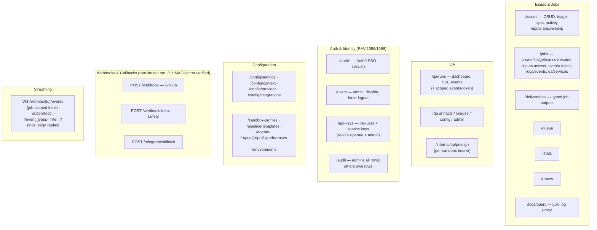

**Endpoint notes:**

- `GET /api/v1/sandboxes/active` — lists live sandbox containers (ops visibility).
- `POST /api/v1/jobs` — accepts `agent_models` (per-agent model override), `job_kind`, and an optional `context` object for repo-less jobs.
- `GET /api/v1/jobs/{id}` — response includes `cost_breakdown` (per-agent aggregated cost/duration/tools) and `current_stage`.
- `POST /api/v1/jobs/{id}/events-token` — mints the short-lived job-scoped WS token (RAV-1070); the raw API key never rides the WS handshake.
- `POST /api/v1/jobs/{id}/qa/log-stream-token` — mints the short-lived job-scoped token the dashboard's live QA log tail (an EventSource, which cannot send a header) passes as `?token=` to `GET /api/v1/jobs/{id}/artifacts/logs/{service}?follow=true` (#634).
- `GET /api/v1/jobs/{id}/logs/events` — one page of the persisted pipeline events, oldest first, each with its `event_seq`; `?since_seq=` and `?limit=` (default 500, at most 1000) page it, and the response's `next_since_seq` and `has_more` say where to continue (#203).
- `GET /api/v1/qa/runs/{job_id}` — a QA run is addressed by the id of the job that ran it (there is no `?job_id=` filter on `/qa/runs`); `GET /api/v1/qa/runs/{job_id}/apps/{app}` returns one app's result, and `GET /api/v1/qa/repos/{owner}/{repo}/runs` lists a repository's runs, newest first.
- `GET/PUT/DELETE /api/v1/repos/{owner}/{repo}/-/preferences` (Plan K) — per-repo preferences override triage (see Triage Decision note below).
- `CRUD /api/v1/environments` (Plan J) — global + per-repo environment variables with Fernet-encrypted secrets (see Environment Variable Storage below).
- Auth model: master `API_KEY` or scoped `emb_` keys (Bearer), Auth0 SSO session cookies on the public origin, per-principal rate limiting; see [sso.md](sso.md) and the audit/API-key routers.

---

## Observability

`GET /metrics` (port 8000) serves Prometheus metrics: generic HTTP metrics
from `prometheus-fastapi-instrumentator`, the process/platform/GC collectors,
and the self-healing-loop metrics (#285) — watcher tick outcomes and liveness,
healing-case funnel and bypass rate, job outcomes by pipeline and error
category, spend, reconciler decisions, and runner/infra bug counters. One
`CollectorRegistry` per app; `embry0/metrics/` holds the facade, and producers
take an injected `LoopMetrics` rather than importing `prometheus_client`.

DB-backed gauges are read on scrape behind a 30 s cache with a hard 2 s
deadline, so a slow or dead Postgres can neither fail nor stall a scrape.
Metrics are an optional subsystem: if they fail to install, the API still
starts without `/metrics`.

The endpoint is LAN-only by topology — nginx proxies no `/metrics` location
and the webhooks tunnel admits only the two webhook paths. Your Prometheus
scrapes `embry0-orchestrator:8000` over the `embry0_backend` network.

**Metric-name contract, exposure and PromQL conventions: [ops/metrics.md](ops/metrics.md).**

---

## Storage

PostgreSQL serves dual duty: application data and LangGraph checkpoints.

```mermaid
erDiagram
    issues {
        string id PK
        string title
        string body
        string status "open|triaging|in_progress|awaiting_input|paused|closed|cancelled"
        string priority "critical|high|medium|low"
        json labels
        string repo "owner/name"
        string parent_issue_id FK "self-referencing"
        string tracker "github|gitlab|linear — null for dashboard/API issues (#161)"
        string tracker_key "GitHub number / GitLab iid (digits), Linear ENG-123"
        string tracker_url
        string tracker_native_id "Linear UUID; null otherwise"
        bool github_sync_enabled "outbound push feature flag, not a tracker ref"
        json notification_channels
        string created_by "user|webhook|triage_agent"
        timestamp created_at
        timestamp updated_at
    }

    issue_inputs {
        string id PK
        string issue_id FK "nullable — issue-less jobs (EMB-43)"
        string job_id FK
        string asking_node "triage|developer|review"
        string question
        string importance "blocking|auto_answerable"
        string auto_answer
        string answer "overrides auto_answer when both set (RAV-1059)"
        string answered_by "session email | key:<name> | telegram:* | github:*"
        int telegram_message_id
        string status "pending|auto_answered|answered|skipped"
        string skipped_by
        timestamp skipped_at
        timestamp created_at
        timestamp answered_at
    }

    jobs {
        string job_id PK
        string status "pending|running|completed|failed|cancelled|awaiting_input|paused|expired|pr_merged|pr_closed"
        string delivery_state "none|pr_open|merged|closed — what became of the PR, independent of status (#280)"
        timestamp delivery_state_at "the forge's time of that state; NULL = derived from status, unconfirmed"
        string error_code "an ErrorCode value — see Failure Classification"
        string trace_id "trc-<12hex> — grep key for the full job timeline"
        string repo "nullable — repo-less jobs (RAV-599)"
        string task
        int issue_number
        string issue_id FK
        string job_kind "code|research|analysis|ops|... (RAV-601)"
        json context "workspace context for repo-less jobs (RAV-599)"
        string current_stage "live pipeline stage"
        string pipeline_template
        json pipeline_config
        float total_cost_usd
        float budget_overrun_usd
        string pr_url
        string error_message
        timestamp created_at
        timestamp started_at
        timestamp finished_at
        timestamp updated_at
    }

    traces {
        string trace_id PK
        string job_id FK
        string agent_type
        string model
        float cost_usd
        int duration_ms
        json tools_called
        string result_summary
    }

    pipeline_templates {
        string id PK
        string name
        string description
        json graph_definition
        string sandbox_profile
        timestamp created_at
        timestamp updated_at
    }

    agent_definitions {
        string type PK
        string description
        string model
        json tools
        json skills
        text system_prompt
        bool is_builtin
    }

    context_config {
        string id PK
        string scope "global|repo"
        string repo "nullable"
        text system_context
        text assistant_context
        timestamp updated_at
    }

    budget_config {
        string id PK
        float max_budget_per_job_usd
        float daily_cap_usd
        float monthly_cap_usd
        int rate_limit_per_author_per_hour
        string overrun_mode "soft|hard"
        timestamp updated_at
    }

    sandbox_profiles {
        string name PK
        string base_image
        json additional_packages
        json setup_commands
        string memory
        string cpus
        int pids_limit
        json cap_drop
        json cap_add
        json security_opt
        int agent_timeout_seconds
        int container_timeout_seconds
    }

    audit_log {
        bigint id PK
        string action
        string actor
        json details
        string issue_id "nullable"
        string trace_id "nullable — same trace_id stamped on jobs row"
        timestamp created_at
    }

    repo_preferences {
        string repo PK "owner/name"
        string sandbox_profile "override of triage decision"
        timestamp created_at
        timestamp updated_at
    }

    global_environment {
        string key PK
        string value "plaintext OR Fernet-encrypted (see type)"
        string type "plain|secret"
        timestamp updated_at
    }

    repo_environment {
        string repo PK "owner/name — composite with key"
        string key PK
        string value "plaintext OR Fernet-encrypted (see type)"
        string type "plain|secret"
        timestamp updated_at
    }

    users {
        string id PK
        string email
        string tier "read|operator|admin (login-time cache of Auth0 roles)"
        bool disabled
        int session_epoch "bump = force logout"
        timestamp created_at
    }

    api_keys {
        string id PK
        string user_id FK "nullable — unowned service keys"
        string name
        string prefix "emb_..."
        string token_hash "sha256 at rest, show-once"
        string scope "read|operate|admin"
        timestamp expires_at
        timestamp revoked_at
        timestamp last_used_at
    }

    deliverables {
        string id PK
        string job_id FK
        string kind "pr|report|analysis|... (RAV-603)"
        json payload
        timestamp created_at
    }

    agent_sessions {
        string job_id PK "composite with agent"
        string agent PK
        json session_state "conversation resume continuity"
    }

    job_logs {
        bigint id PK "BIGSERIAL — doubles as the WS event_seq"
        string job_id FK
        string agent_id
        string stream
        text text "JSON event payloads"
    }

    watcher_runs {
        string id PK
        string status
        json findings "log-watcher tick audit trail (RAV-657)"
        string repo "which watched stack this tick was for (#378)"
        string tracker "linear | github | gitlab — where its draft was filed"
        string tracker_key "the filed ticket: ENG-123, or a bare issue number"
        timestamp created_at
    }

    healing_cases {
        string id PK
        string repo
        string origin "watcher | human | webhook | alert | ci (validated in code)"
        string stage "detected → … → closed (services/healing/lifecycle.py)"
        string resolution_path "embry0 | out_of_band | cancelled | non_code | self_resolved | abandoned"
        string severity
        string fixability
        int occurrence_count "with last_seen_at"
        string signature_id "FK-ready for log_signatures (#289)"
        string signature_source "evidence | fallback: how the watcher chose signature_id (#657)"
        string watcher_run_id FK
        string tracker_key "with tracker + tracker_url; one OPEN case per ticket"
        string issue_id FK
        string merge_sha
        string deploy_sha "first deploy carrying the merge; with deploy_marker_at + deploy_services"
        string healed_verdict "pending | healed | not_healed | inconclusive | regressed"
        string parent_case_id FK "the closed case this one follows"
        string caused_regression_case_id FK
    }

    healing_case_jobs {
        string case_id PK
        string job_id PK
    }

    healing_case_prs {
        bigint id PK
        string case_id FK
        string url UK
        int number
        string head_sha "guarded by head_sha_at"
        string state "open | merged | closed"
        string merge_sha
        string job_id FK
    }

    healing_case_events {
        bigint id PK
        string case_id FK
        string event
        string event_key "idempotency key, unique per case"
        string from_stage
        string to_stage
        json detail "detail.updates = the exact column change"
    }

    watcher_known_patterns {
        string id PK
        string fingerprint
        text rationale "known-benign registry (RAV-1138)"
    }

    integration_config {
        string id PK
        string github_token_hint
        string webhook_notify_url "outbound events (RAV-1052)"
        string webhook_notify_secret
    }

    provider_config {
        string id PK
        string provider_mode
        string model_light
        string model_medium
        string model_heavy
    }

    qa_app_results {
        string id PK
        string job_id FK
        string app
        string status "passed|failed|inconclusive"
        json raw_result "acceptance_results per criterion"
        json boot_phase
    }

    qa_run_metadata {
        string job_id PK
        string head_sha
        json affected_set
        json conditional_groups
    }

    qa_image_tags {
        string repo PK
        string tag "pre-baked sandbox image registry"
    }

    qa_volume_state {
        string repo PK "composite with scope"
        string scope
        json warmth "shared-volume warmth tracking"
    }

    issues ||--o{ jobs : "spawns"
    issues ||--o{ issue_inputs : "has questions"
    issues ||--o{ issues : "parent/child"
    jobs ||--o{ traces : "has"
    jobs ||--o{ issue_inputs : "produced by"
    sandbox_profiles ||--o{ pipeline_templates : "referenced by"
    repo_preferences ||--o{ jobs : "may override triage for"
    jobs ||--o{ deliverables : "produces"
    jobs ||--o{ job_logs : "streams"
    jobs ||--o{ agent_sessions : "per-agent state"
    jobs ||--o{ qa_app_results : "per-app QA outcomes"
    users ||--o{ api_keys : "owns (nullable)"
    watcher_runs ||--o| healing_cases : "proposal opens"
    issues ||--o{ healing_cases : "accepted as"
    healing_cases ||--o{ healing_case_jobs : "fix attempts"
    jobs ||--o{ healing_case_jobs : "linked to"
    healing_cases ||--o{ healing_case_prs : "every PR it had"
    jobs ||--o{ healing_case_prs : "opened"
    healing_cases ||--o{ healing_case_events : "history"
    healing_cases ||--o{ healing_cases : "regression of"
```

LangGraph checkpoint tables (`checkpoints`, `checkpoint_blobs`, `checkpoint_writes`) are managed by `langgraph-checkpoint-postgres` and provide pause/resume, time-travel debugging, and state inspection.

### Skill Storage

Two tables, both from migration 101; the trees themselves live in the skills store ([Skills store and mounts](#skills-store-and-mounts)), not in Postgres.

| Table | Holds |
|---|---|
| `skill_sources` | One row per source (`git`, `path` or `inline`): url and requested `ref`, the `resolved_sha` the store holds, the `plugin_name` that prefixes its skill names, the `skills` catalog read at sync, `status` (`pending`, `ready`, `error`) with the redacted `error`, `enabled`, `is_builtin`, and `credential_id`, reserved and always null |
| `inline_skills` | SKILL.md documents written through the API (`name`, `description`, `body`), rendered into the builtin `local` source |

### Environment Variable Storage (Plan J)

Per-repo and global environment variables are stored in `global_environment` / `repo_environment`. Variables of type `secret` are Fernet-encrypted at rest using a key derived from `ENVIRONMENT_SECRET_KEY` via PBKDF2-HMAC-SHA256. Responses mask secret values (`****`); a separate `/reveal` endpoint returns plaintext and emits an `environment.secret_revealed` audit event.

Reserved keys (`EMBRY0_GIT_PROXY_URL`, `EMBRY0_CONTEXT_PROXY_URL`, `CLAUDE_CODE_OAUTH_TOKEN`, `ANTHROPIC_API_KEY`, `ANTHROPIC_AUTH_TOKEN`, `ANTHROPIC_BASE_URL`, `XAI_API_KEY`, `GITHUB_TOKEN`) — matched case-insensitively, plus reserved prefixes — are blocked at the API layer and again at sandbox injection time to prevent users from hijacking orchestrator-injected infrastructure variables. In production the orchestrator **refuses to start** without `ENVIRONMENT_SECRET_KEY`; only `auth_dev_mode` tolerates a missing key (ephemeral per-process key, CRITICAL log). The key is rotatable without orphaning stored secrets (RAV-1070): move the old key into `ENVIRONMENT_SECRET_KEYS_OLD` (comma-separated, newest first), set a fresh `ENVIRONMENT_SECRET_KEY`, and restart — decryption tries all listed keys (MultiFernet) while encryption always uses the current one. A ciphertext no listed key can open surfaces as `secret_decryption_failed` on the next job that needs it.

### ID Prefix Conventions

All primary keys and correlation IDs follow a `<type>-<12-char-hex>` format:

| Prefix | Column | Table | Notes |
|--------|--------|-------|-------|
| `job-` | `job_id` | `jobs` | Primary key; generated by `JobsRepository` |
| `issue-` | `id` | `issues` | Primary key; generated by `IssuesRepository` |
| `trc-` | `trace_id` | `traces` | Primary key; generated by `TracesRepository` |
| `trc-` | `trace_id` | `jobs`, `audit_log` | Cross-span correlation key; generated by `IssueExecutor` |

Note: `traces.trace_id` and `jobs.trace_id` / `audit_log.trace_id` share the `trc-` prefix but are distinct concepts. A `traces` row captures one agent's telemetry; the correlation `trace_id` groups all agents across a full issue execution. They are never joined on this column.

### Migrations Reference

The migration runner (`embry0/storage/migrations/runner.py`) applies these idempotently, in order, on orchestrator startup.

The whole pass is serialised across processes by a session-level Postgres advisory lock (`MIGRATIONS_ADVISORY_LOCK_KEY`, ASCII `embry0`), taken before the ledger table is even created and released in a `finally` (#249). A second orchestrator — rolling restart, a second stack on a shared Postgres, a multi-replica deployment — blocks on the lock, then re-reads the applied set and finds nothing to do. The lock is session- rather than transaction-scoped so each migration keeps its own transaction: a failure rolls back only that entry, and the next startup resumes from the ledger instead of replaying. Advisory-lock keys are database-wide, so any new advisory lock in embry0 must pick a different key and be registered in the runner's header.

| # | Description | Tables/Columns |
|---|---|---|
| 1 | Initial schema | `jobs`, `traces`, `audit_log`, `job_logs` |
| 2 | Agent definitions, integration config, provider config | `agent_definitions`, `integration_config`, `provider_config` |
| 3 | Pipeline templates description column | `pipeline_templates.description` |
| 4 | Issues table + issue_id FK on jobs | `issues`, `audit_log.issue_id` |
| 5 | Human-in-the-loop questions | `issue_inputs` |
| 6 | Remove validator/output agents, rename reviewer → review | `agent_definitions` seed |
| 7 | Add updated_at to jobs | `jobs.updated_at` + trigger |
| 8 | Add error_code to jobs | `jobs.error_code` |
| 9 | Add trace_id threading | `jobs.trace_id`, `audit_log.trace_id` |
| 10 | Environment variables with encryption | `global_environment`, `repo_environment` |
| 11 | Per-repo preferences | `repo_preferences` |
| 12 | Pluggable agent execution modes | `repo_preferences.execution_mode`, `agent_definitions.execution_mode` |
| 13 | Drop untouched seed rows for provider/integration config | `provider_config`, `integration_config` |
| 14 | Bump default developer agent model to claude-opus-4-7 | `agent_definitions` seed |
| 15 | FK ON DELETE policies — CASCADE / SET NULL | All FK constraints |
| 16 | Performance indexes — GIN + composite | `issues`, `job_logs`, `traces` |
| 17 | Unify trace_id prefix from `trace-` to `trc-` | `traces.trace_id` |
| 18 | Sandbox profile QA fields | `sandbox_profiles.{base_image, additional_packages, additional_commands, env_vars}` for Phase 0 QA foundation |
| 19 | Env var scope (app vs qa) | `global_environment.scope`, `repo_environment.scope` (`app`/`qa`); QA scope only injected when QA pipeline runs |
| 20 | Agent definitions MCP servers | `agent_definitions.mcp_servers` (JSONB) — lets the QA agent declare its browser-backend MCP server in the seed |
| 21 | notification_channels JSONB column (which channels get agent questions) | `issues` |
| 22 | add skipped_by/skipped_at audit columns for /skip directive | `issue_inputs` |
| 23 | per-(job, agent) conversation state for resume continuity | `agent_sessions` |
| 24 | per-app QA outcomes for multi-app monorepo runs | `qa_app_results` |
| 25 | extend status CHECK to include 'inconclusive' | `qa_app_results` |
| 26 | pre-baked sandbox image registry per repo | `qa_image_tags` |
| 27 | shared-volume warmth tracking per (repo, scope) | `qa_volume_state` |
| 28 | boot_phase JSONB for per-sub-task boot drilldown | `qa_app_results` |
| 29 | affected-set + diff snapshot per QA run | `qa_run_metadata` |
| 30 | recast legacy JSON-string-scalar JSONB rows to real JSONB objects | — |
| 31 | per-repo dashboard-set provider config | `qa_workspace_provider_overrides` |
| 32 | head_sha column for flake-heatmap aggregation | `qa_run_metadata` |
| 33 | is_builtin flag for canonical seed pipelines | `pipeline_templates` |
| 34 | make repo nullable + add context JSONB for non-code jobs | `jobs` |
| 35 | current_stage column for live pipeline-stage surfacing | `jobs` |
| 36 | extra_hosts for deployed-target QA (EMB-28) | `sandbox_profiles` |
| 37 | conditional_groups for relevance-gated criteria (EMB-39) | `qa_run_metadata` |
| 38 | per-run token usage columns (EMB-35) | `traces` |
| 39 | nullable issue_id for issue-less jobs (EMB-43) | `issue_inputs` |
| 40 | linear_identifier + linear_issue_id for the Linear trigger (EMB-47) | `issues` |
| 41 | per-repo git author identity override (EMB-51) | `repo_preferences` |
| 42 | jobs.job_kind + pipeline_templates.default_for_kind (RAV-601) | — |
| 43 | typed job outputs beyond the PR (RAV-603) | `deliverables` |
| 44 | audit trail for the log-watcher/proposer (RAV-657) | `watcher_runs` |
| 45 | outbound notification webhook url + secret (RAV-1052) | `integration_config` |
| 46 | audit trail for the post-merge auto-deployer (RAV-658) | `deploy_runs` |
| 47 | the RAV-658 auto-deployer is removed | `drop deploy_runs` |
| 48 | verdict rationale + known-benign pattern registry (RAV-1138) | `watcher briefing pack` |
| 49 | SSO identity mirror + session control (RAV-1056 Phase A) | `users table` |
| 50 | per-user + service API keys (RAV-1056 Phase B) | `api_keys table` |
| 51 | actor/action filters (RAV-1056 Phase C) | `audit_log read-path indexes` |
| 52 | repos registry + DB-native qa.yaml store (RAV-1251) | `repos`, `repo_qa_configs` |
| 53 | DB-native dev-check contract (RAV-1254) | `repo_preferences` |
| 54 | per-model enablement (RAV-1297) | `provider_config.disabled_models` |
| 55 | remove zombie agent rows resurrected by the ledger rename (RAV-1288) | `agent_definitions` |
| 56 | override channel retired (RAV-1300; supersedes 31) | `drop qa_workspace_provider_overrides` |
| 57 | bump builtin agent models to the Claude 5 family | `agent_definitions` |
| 58 | Linear credentials Settings-manageable (#157) | `integration_config` |
| 59 | forge discriminator on repos (#162) | `repos.forge` |
| 60 | generic tracker reference columns (#165) | `issues.tracker*` |
| 61 | fold github_*/linear_* refs onto the generic columns (#161) | `issues` backfill + drops |
| 62 | which GitHub comment rendered each question (#253) | `issue_inputs.github_comment_id`, `.github_comment_seq` |
| 63 | the actor that triggered a job (#246) | `jobs.dispatched_by` |
| 64 | the repo's integration branch (Spec 1A §3.7) | `repo_preferences.base_branch` |
| 65 | no-op since #527 (it once rewrote one deployment's stored URLs after a repo rename, #277; renames are now `REPO_RENAMES`) | none |
| 66 | watcher tick diagnostics: degraded briefing, analysis retry + cost, window gap, line cap (#288) | `watcher_runs.briefing_failures`, `.retried_job_id`, `.analysis_cost_usd`, `.unanalysed_seconds`, `.log_lines_truncated` |
| 67 | tracker dispatch ledgers: once-per-reason "not dispatched" ticket comments, and dispatch failures for the reconciler's backoff (#284) | `tracker_dispatch_notices`, `tracker_dispatch_failures` |
| 68 | release a watcher cap slot without erasing the ticket id (#278) | `watcher_runs.released_at` |
| 69 | healing-case lifecycle ledger (#278) | `healing_cases`, `healing_case_jobs`, `healing_case_prs`, `healing_case_events` |
| 70 | a watcher tick leaves a trace when it starts, so restarts schedule from it (#335) | `watcher_tick_attempts` |
| 71 | per-run failure record; data-only backfill of unambiguous historical `jobs.error_code` values, `updated_at` preserved (#281) | `traces.error_code`, `traces.stderr_tail` |
| 72 | verification: per-repo test-gate/tier config + one durable result per job (#298, #299) | `repo_preferences.verification`, `job_verifications` |
| 73 | what became of a job's pull request, apart from how the job ended (#279, #280) | `jobs.delivery_state` (`none`/`pr_open`/`merged`/`closed`, seeded from `status` + `pr_url`), `jobs.delivery_state_at` (the forge's time; `jobs.updated_at` preserved) |
| 74 | bound the analyses a full draft cap no longer bounds (#283) | `watcher_runs.analysed_under_full_cap` |
| 75 | pre-built QA image base digest; exactly one active image per repo — deactivates all but the newest active row per repo, deletes nothing (#334) | `qa_image_tags.base_image`, `.base_image_digest`, `ck_qa_image_tags_base_pair`, `uq_qa_image_tags_one_active_per_repo` |
| 76 | deterministic log clustering memory: one row per (signature, repo) behind "is this new?" and "is this getting worse?" (#289) | `log_signatures`, `idx_log_signatures_repo_last_seen`, `idx_log_signatures_repo_count` |
| 77 | the daily digest is sent once per UTC day: the sender claims the day before it sends and keeps what it sent | `digest_deliveries` |
| 78 | "merge this PR?" from the chat: one row per ask, pinned to the PR's head sha; the `merge` API key scope | `merge_approvals`, `uq_merge_approvals_one_pending_per_pr`, `idx_merge_approvals_job`, `api_keys_scope_check` (admits `merge`) |
| 79 | the ask is posted once the PR's CI settles and retires itself: `closed` when the PR is merged or closed on the forge, `expired` when left untouched | `merge_approvals.posted_at`, `merge_approvals_status_check` (adds `closed`, `expired`), `idx_merge_approvals_pending_posted` |
| 80 | data-only: unwrap the double-encoded JSON `ask` strings 78 and 79 wrote; idempotent | `merge_approvals.ask` |
| 81 | data-only: the same unwrap for the digest payload and the clustering sample lines (#382) | `digest_deliveries.payload`, `log_signatures.sample_lines` |
| 82 | watcher runs, known patterns and tick attempts are scoped to a stack, the ticket columns are tracker-neutral, and one open healing case per tracker ticket (#378, #317) | `watcher_runs.{repo, tracker, tracker_key, tracker_url}` (drops `linear_issue_identifier`), `idx_watcher_runs_repo_created`, `watcher_known_patterns` pkey `(fingerprint, repo)`, `watcher_tick_attempts.repo` as pkey (drops `id`), `idx_healing_cases_open_tracker` |
| 83 | what embry0 watches, one row per stack: its LogQL, where findings are filed, and the settings that differ from the global defaults (#378, #297) | `watcher_stacks` |
| 84 | a case accepted, attempted and given up closes as `abandoned` (#410) | `healing_cases_resolution_path_check` |
| 85 | data-only: stamp `released_at` from `accepted_at` on drafts a human already accepted (#415) | `watcher_runs.released_at` |
| 86 | credential registry: the accounts embry0 acts as, which one a repo, owner, host or the deployment uses per role, and the per-job ledger (spec 2026-09-29) | `credentials`, `credential_bindings`, `credential_bindings_single`, `credential_uses`, `credential_uses_job`, `credential_uses_cred` |
| 87 | the shared Docker daemon is an admin grant per repo; a repo already on a `dind_enabled` profile keeps it (#522) | `repos.docker_access` |
| 88 | per-key repository allowlist: NULL is any repository, an empty array is refused | `api_keys.allowed_repos`, `api_keys_allowed_repos_not_empty` |
| 89 | data-only: `finished_at` for terminal rows written without one, from `updated_at`, with the `updated_at` trigger disabled for the pass (#345) | `jobs.finished_at` |
| 90 | data-only: drop per-job volume rows whose job has ended or has no jobs row (#328) | `qa_volume_state` |
| 91 | drop the per-template model map nothing read (#468) | `pipeline_templates.agent_models` (dropped) |
| 92 | a restart recovers jobs instead of failing them (#307) | `jobs.interrupted_at`, `jobs.resume_attempts`, `jobs.launch` |
| 93 | drop the QA trace URL column nothing set (#644) | `qa_app_results.trace_url` (dropped) |
| 94 | how the watcher chose a case's signature: the proposal's own evidence, or the loudest cluster as the fallback (#657) | `healing_cases.signature_source` |
| 95 | job_logs correlation columns lifted out of the JSON; a trace row is written at run start as `running` (#36) | `job_logs.{run_id, node, event_type}` (drops `agent_id`), `idx_job_logs_job_event_type`, `idx_job_logs_run_id` |
| 96 | review a pull request when it is ready: one row per review a trigger asked for, deduped on `trigger_key` (#30) | `repo_preferences.pr_review`, `pr_reviews`, `idx_pr_reviews_trigger_key`, `idx_pr_reviews_repo_number` |
| 97 | the forge owners embry0 maintains as a whole: forge, the credential it acts with and the probed `access` (ADR 0010) | `organizations` |
| 98 | what discovery found under an owner: one fact row per repository, replaced on every run, plus the runs ledger (ADR 0010) | `org_repo_facts`, `idx_org_repo_facts_owner`, `org_discovery_runs`, `idx_org_discovery_runs_owner` |
| 99 | what embry0 still needs to maintain an owner, keyed by (owner, kind, signature) so an answer survives rediscovery (ADR 0011) | `org_needs`, `idx_org_needs_owner`, `org_needs_synced` |
| 100 | the machines that run the code, which repositories run on each, and the `tailnet_api_key` credential kind (ADR 0013) | `hosts`, `hosts_name_unique`, `repo_hosts`, `idx_repo_hosts_host`, `credentials.metadata`, `credentials_kind_check`, `credentials_provider_check`, `credential_bindings_role_check` |
| 101 | agent identity (`display_name`, `avatar`, `color`, `tagline`, with the builtins' values written for rows still at the defaults), skill sources and inline skills | `agent_definitions.{display_name, avatar, color, tagline}`, `skill_sources`, `inline_skills` |
| 102 | an owner's versioned standards and each repository's place under them: one active version per owner and kind, superseded versions as history (ADR 0014) | `standards`, `standards_one_active`, `repo_standard_state`, `idx_repo_standard_state_owner`, `idx_repo_standard_state_audit_job` |
| 103 | `credentials.provider` takes the OpenAI-compatible LLM providers (openai, openrouter, google, groq, deepseek, custom; ADR 0018) | `credentials_provider_check` |
| 104 | every change to a repository's stored test setup and preferences, newest 100 per repo and surface, outliving the repository (ADR 0019) | `repo_config_revisions`, `idx_repo_config_revisions_repo` |
| 105 | agent-proposed test setups a person applies, one running or pending proposal per repository (ADR 0019) | `repo_setup_proposals`, `idx_repo_setup_proposals_repo`, `uq_repo_setup_proposals_live` |
| 106 | the eight specialist agents' identity (`display_name`, `avatar`, `color`, `tagline`) written for rows still at the defaults, as 101 did for the core agents | `agent_definitions` rows |
| 107 | each run's tool calls by the skill they train, keyed `kind:skill`, for progression (spec 2026-10-24) | `traces.skill_actions` |
| 108 | owner proposals: each repository's owners, every answer an owner gives a proposal, and the `propose` key scope (spec 2026-10-24) | `repo_preferences.owners`, `proposal_decisions`, `idx_proposal_decisions_proposal`, `api_keys_scope_check` |
| 109 | the area of a monorepo a job's pull request changes, from the repository's `.embry0/areas.yml` (spec 2026-10-25) | `jobs.area` |
| 110 | leads: work embry0 finds by itself (backlog tickets, failing CI on the default branch, dependency and code-scanning alerts, flaky checks, unanswered review threads), upserted by the finders and marked gone, never deleted; the proposal answer kinds widen to match (spec 2026-10-25) | `leads`, `idx_leads_state_repo_kind`, `proposal_decisions_kind_check` |
| 111 | what the last analysis found in each log signature, for the watcher's novelty gate (spec 2026-10-25) | `log_signatures.analysed_at`, `analysed_verdict`, `analysed_count` |
| 112 | the player's evaluation of a finished quest: a rating, what they did with the work and the follow-up a send-back started (the world, spec 2026-10-25) | `job_ratings` |
| 113 | provider fallback: the models, in order, an agent runs on when its own model's provider has no usable account (`[]` is off), and on each run's trace what a fallback model stood in for (spec 2026-10-25) | `provider_config.fallback_models`, `traces.fallback` |
| 114 | provider_catalogs: OpenRouter's live model list, every model with tool calling at its own price; a failed refresh keeps the last good list (docs/providers.md) | `provider_catalogs` |
| 115 | local models: how many agent runs the operator's own model server takes at once, the model the watcher's analyses run on first while a slot is free (`''` is off), and a lease per run on one of its slots, expiring by itself ([providers](providers.md#local-models)) | `provider_config.local_max_runs`, `provider_config.watcher_local_model`, `local_model_leases` |
| 116 | spent account waits: what a paused job waits for when its LLM account is spent with nothing ready to move to (provider, reason, until, mode), read by the account-wait loop that goes on with it ([providers](providers.md#spent-account-waits)) | `jobs.account_wait`, `idx_jobs_account_wait` |
| 117 | proposal briefs: each owner proposal still asked, in plain words (title, problem, fix, size), written by a model from what embry0 holds about it; a changed proposal gets a new one ([spec](superpowers/specs/2026-10-25-proposal-briefs-design.md)) | `proposal_briefs` |
| 118 | slop is not a bug: the slopometer's verdict on a code job (nature bug, slop or noise, a slop score, kinds, evidence, and a cleanup's diff counts) and on a watcher finding ([spec](superpowers/specs/2026-10-25-slop-dungeon-design.md)) | `jobs.work_nature`, `healing_cases.work_nature` |
| 119 | job briefs: each job in plain words (title, what, why, done, size), written by a model from its task and what embry0 knows about it; a changed task or a new prompt gets a new one ([spec](superpowers/specs/2026-10-26-job-briefs-design.md)) | `job_briefs` |
| 120 | done when: the finish line a code job works to (conditions with how each is shown, out of scope, who set it, and the coding run's report on it), drafted by triage or taken from the ticket, replaceable by a person ([spec](superpowers/specs/2026-10-26-done-when-design.md)) | `jobs.done_when` |
| 121 | the slop-o-meter: each repository's history as read (commits with per-file line counts and trailers, forge events, login emails, outlier commit judgments), where reading stands, and the weekly series and current score per repository and area ([spec](superpowers/specs/2026-10-26-slop-o-meter-design.md)) | `slop_meter_repos`, `slop_meter_commits`, `slop_meter_events`, `slop_meter_logins`, `slop_meter_judgments`, `slop_meter_weeks`, `slop_meter_scores` |
| 122 | slop-o-meter: how each repository's history was read (`history_version`), so a better way of reading (renames found, version 2) reads it again ([spec](superpowers/specs/2026-10-26-slop-o-meter-design.md)) | `slop_meter_repos.history_version` |
| 123 | scout: the loop's runs, and its two lead kinds, `crack` (a kintsugi ledger row) and `weed` (a garden weed card), read from scouting jobs pinned to the local model ([leads.md](leads.md#the-scout-cracks-and-weeds)) | `scout_runs`; the `leads` and `proposal_decisions` kind checks |
| 124 | knowledge maps: the last upload of each map, each person's mark on a part, and every part sent to an agent ([maps.md](maps.md)) | `knowledge_maps`, `knowledge_map_marks`, `knowledge_map_sends` |
| 125 | decisions: a person's GitHub login (`users.github_login`), linking who signs in to the owners proposals name, and hand-offs, a decision one person sent another, at most one open per decision ([spec](superpowers/specs/2026-10-27-decisions-design.md)) | `users.github_login`; `handoffs` |
| 126 | decisions: asks, one message to one person about one decision tracked from queued to answered or expired, and each decision's code, never given to another decision ([spec](superpowers/specs/2026-10-27-decisions-design.md)) | `asks`; `decision_codes` |
| 127 | agent avatars: the adventurer presets renamed with the original progression theme (silver to obsidian and crimson warriors, the sorcerer, the artisan); a stored avatar keeps its look under its new name | `agent_definitions.avatar` |
| 128 | config revisions: every change to a settings document, before and after, with its actor, source and reason; the newest 100 per scope and surface ([ADR 0026](adr/0026-settings-document.md)) | `config_revisions` |
| 129 | settings documents: the deployment's operator policy as one YAML document, its validated values, its write counter (`generation`) and the keys whose environment values were imported (`bootstrapped_keys`) ([ADR 0026](adr/0026-settings-document.md)) | `settings_documents` |
| 130 | progression: the content pack an operator edits (#176), one active version and one draft at most, every activation a version (the newest 100 superseded kept); no row means the shipped default. `progression_pack_defaults` keeps the text of each shipped default a stored pack was based on | `progression_packs`, `progression_pack_defaults` |
| 131 | progression: the closed days folded once per content pack, so a read folds only the last few days' events (the XP per day, character and skill, every milestone at its exact time, what the fold carried past the boundary, and the version of the code that folded it), and two trace indexes for those reads ([progression.md](progression.md#how-experience-is-read)) | `progression_rollups`, `progression_daily`, `progression_milestones`, `idx_traces_created_at`, `idx_traces_success_agent` |
| 132 | jobs: a partial index on `pr_url` (rows that have one), so the `first_try` achievement fact finds a pull request's earlier jobs through indexes instead of scanning `jobs` once per merged job (#208) | `idx_jobs_pr_url` |
| 133 | knowledge maps: each map's owner (its repository's owner, lowercased; none for a map without one, an admin's alone), keyed by slug and owner with a unique index that treats no owner as one owner (`NULLS NOT DISTINCT`, so PostgreSQL 15 or later), so two owners can each have a map of a slug; marks, sends and the maps' weed leads carry their map's owner. The stored graph text is not read or rewritten ([maps.md](maps.md#who-owns-a-map)) | `knowledge_maps.owner`, `uq_knowledge_maps_slug_owner`, `knowledge_map_marks.map_owner`, `uq_knowledge_map_marks_part`, `knowledge_map_sends.map_owner` |
| 134 | settings documents: a layer per organization (`organization:<owner>`) and per repository (`repository:<owner>/<name>`) beside the deployment's document, each created by its first write; the deployment's row is unchanged (spec 2026-10-29, #161) | `settings_documents` (scope check widened) |
| 135 | background spend: one row per model call a background feature makes outside a job (the briefs, the Slop-O-Meter's judge), with the feature, the model, the repository, the tokens and their price; counted by the budget caps and `/stats` (#164) | `background_spend` |
| 136 | background scope exits: when a repository left a background feature's scope, so the Slop-O-Meter removes what it kept of it only `background.prune_after_days` later, and not at all if it comes back first (#165, [what the background features keep](ops/background-data.md)) | `background_scope_exits` |
| 137 | asks: when the feed first handed an ask out, set once in the statement that hands it out, so an ask never reported sent expires `expire_days` after it and keeps its person from being asked again for another `expire_days` only (#295) | `asks.handed_out_at` |
| 138 | the brief writer's voices (#166): `agent_definitions.runs_in_jobs`, false for a definition no job runs (the `proposal-brief` and `job-brief` voices: no template step, no job form override, no guild character), and `prompt_hash` on both brief tables, the system prompt each brief was written with, so a changed voice rewrites the old briefs a few a tick while readers keep matching on `input_hash` (NULL is the prompt each loop sent before, recorded in the code as a literal hash) | `agent_definitions`, `proposal_briefs`, `job_briefs` |
| 139 | the hand-out lease (#293): `asks.lease_until`, until when an ask `GET /asks/due` handed out is held for the poll that took it, counted toward its person's limit and handed to no other poll; NULL when never handed out or reported sent since. `handed_out_at` stays the first hand-out, which the expiry of an ask never reported sent counts from (#295) | `asks` |
| 140 | the API key that created a credential: `credentials.created_by_key_id`, so a credential nothing uses yet is the own of the key whose id it records, never of another key of the same name; NULL for one a session, the master key or the importer created, and for every credential created before it, none back-filled, so no restricted key owns one of those | `credentials.created_by_key_id` |

Note: LangGraph's checkpoint tables (`checkpoints`, `checkpoint_blobs`, `checkpoint_writes`) are created and mutated by `langgraph-checkpoint-postgres` / `orchestration/checkpoint.py`, outside `embry0_migrations` entirely — they're excluded from this ledger by design, not an oversight.

---

## Job Lifecycle & Executor

The `IssueExecutor` (`embry0/services/issue_executor.py`) owns the lifecycle of every background coroutine spawned to run a workflow.

**Task lifecycle.** `IssueExecutor._track_task(coro, *, kind, job_id, issue_id)` is the single entry point for creating background coroutines. It registers the task in both `_background_tasks` (set) and `_tasks_by_job` (dict) and attaches a done-callback that logs non-`CancelledError` failures and publishes a `job_failed` WS event. `IssueExecutor.cancel_job(job_id)` is the centralised cancellation flow: cancel the live task (with a 5s grace), destroy the sandbox, release the job's QA resources (fan-out sub-task sandboxes, `qa-net-*` networks, agent-started containers — `cleanup_cancelled_qa_job`) and its per-job volumes along with their `qa_volume_state` rows, update job+issue status, purge LangGraph checkpoints for the thread, and emit a `job.cancelled` audit event.

**Restarts: drain and recovery (#307).** Sandboxes outlive the orchestrator (they run on the agent runtime) and LangGraph checkpoints every node, so a restart stops jobs rather than losing them.

- *Drain.* The lifespan's shutdown first calls `IssueExecutor.drain(SHUTDOWN_DRAIN_SECONDS)`, before any background task is cancelled. From then on `_run_in_slot` starts nothing: a job dispatched during the drain, or one waiting for a run slot (cancelled at once), stays `pending`; `schedule_resume` raises `ExecutorDraining`. A running issue-to-PR job stops at its next node boundary: `_process_stream` raises `ShutdownInterrupt` (a `BaseException`, so no failure path sees it) once a node's update has streamed, and closes the stream so the next node is cancelled and the pending checkpoint writes are flushed. QA, onboard and pr-review jobs are let run to the deadline. Jobs still running then are cancelled. Each job stopped or held back gets `jobs.interrupted_at`, and `SandboxManager.stop_agent` kills the runner it left in its sandbox: killing the `docker exec` client does not.
- *Launch records.* Every dispatch entry point (`execute`, `submit_job`, `start_job`, `start_onboard_job`, `start_pr_review_job`) passes `_track_task` a `launch` dict — the runner kind and its arguments — which `_run_in_slot` stores in `jobs.launch` before the job waits for anything. `relaunch(job)` starts the job again from it.
- *Recovery.* At boot, `orchestration/restart.py`'s `take_back_jobs` reads every `running`/`pending` row and `plan_recovery` decides: a `running` job with a checkpoint, on a resumable pipeline (not `qa`/`onboard`/`pr-review`), is resumed; a `pending` job, or a `running` one whose graph never began, with a launch record, is launched again; anything else is left to `fail_orphaned`, which now stamps `finished_at` and words a drained job as `ERR_INTERRUPTED_BY_SHUTDOWN`. Recovered jobs are started at the end of startup, once the executor and the proxies exist: `resume_after_restart` runs `resume(..., after_restart=True)`, which streams `None` (go on from the checkpoint) after `_reclaim_sandbox_after_restart` kills the stale agent and re-enrolls the sandbox (or, with no sandbox in the checkpoint, removes a half-made `sandbox-<job_id>` so `init` creates it again). LangGraph re-runs only the node that had not finished.
- *Bound.* A recovery after an unclean stop (no `interrupted_at`) spends one `jobs.resume_attempts`; at `MAX_RESUME_ATTEMPTS` boot fails the job with `ERR_RESUME_LIMIT`. Recovery clears `interrupted_at`, so each stop is judged on its own. Migration 92 adds the three columns.

**Trace ID threading (Plan H).** Every job is assigned a `trace_id` (format `trc-<12hex>`) at creation; the id is bound to structlog contextvars for the duration of `_run_workflow` and persisted onto every `audit_log` row written in that span. Use it as a grep key to reconstruct an issue's full timeline across logs and audit events.

**Done when (the finish line, spec 2026-10-26).** Triage writes `done_when` for a code job, and `plan_route` keeps it on state and on `jobs.done_when`. When triage gives none, the ticket's own criteria serve (`## Acceptance criteria` by default), and a list a person set wins.
- **Its policy.** The ticket headings (`Acceptance criteria`) and the number of retries (one) are the settings document's `done_when` section (the first heading, in order, whose section lists bullets is read, by `done_when.ticket_criteria`, the one rule the ticket's list and review share), which an organization's or a repository's layer may override. `_run_workflow` reads it, with `salvage`, for the job's repository once, when the job starts, and keeps them on the checkpointed state (`job_settings`, `embry0.services.job_settings`). Triage's prompt, `plan_route`, the developer's contract, the check, the pause and review all read them from there, so a resumed job keeps what it started with and a change reaches the next job.
- **Before the run.** `developer_node` reads the job row at the start of every run, so an edit counts from the next run. It appends the list as the run's contract (`embry0.services.done_when.contract`), and `run_agent_node` adds pacing in turns to the coding step's turn-budget note.
- **After a run that pushed,** `nodes/_done_when.check_done_when` reads the report in the final JSON strictly:
  - all met → the route goes on;
  - an item unmet or unreported → `developer` again, with `done_when_followup` naming the unmet items, while `done_when_retries` is below the job's `done_when.retries`;
  - still unmet → `max_retries` at stage `done_when_unmet`.
- **Review and QA.** The review prompt's finish line is the list plus the report, in place of the ticket's criteria section. QA adds the items after each app's own criteria when triage named none.

**Agent-initiated questions (Plan L — `ask_user`).** Agents can pause the pipeline mid-execution by calling `embry0.sandbox.ask_user(question, category, options)`. The sandbox runner emits `agent_ask_user` events; `developer_node` picks them up and the graph routes to `ask_user_interrupt`, which raises `interrupt(...)` with the pending questions. `_handle_needs_info` persists questions to `issue_inputs` and transitions status to `awaiting_input` (reusing the triage-question infrastructure). On resume via `Command(resume=answers)`, the developer re-runs with a Q&A block prepended to its prompt. Capped per job (default 10 rounds, env-tunable via `ASK_USER_ROUNDS_CAP`); past that the job fails with `ERR_MAX_AGENT_QUESTIONS`.

### Failure Classification

Failures populate the `jobs.error_code` column (migration 8) with one of the canonical values in `embry0.safety.error_codes.ErrorCode`:

| Code | Meaning |
|------|---------|
| `ERR_AGENT_TIMEOUT` | Agent SDK call exceeded its configured timeout. The runner kills the agent inside the sandbox as well as its `docker exec` client, since the job pauses with its sandbox kept; `agent_runner_wall_clock_timeout` records whether that kill landed (`runner_stopped`). |
| `ERR_NO_RESULT` | Sandbox produced no final `ResultMessage`. |
| `ERR_BUDGET_OVERRUN` | The job ran and its per-job cap stopped it in-run (`overrun_mode=hard`). It spent money, so it counts toward its actor's rate limit and toward dispatch-attempt caps. Rows written before #331 also carry this code for gate refusals; readers tell those apart by evidence (no `traces` row and `budget_overrun_usd = 0`). |
| `ERR_BUDGET_REFUSED` | The dispatch gate refused the job before any agent ran — a daily/monthly cap or the per-actor rate limit (#331). The only outcome exempt from rate-limit and attempt counts; the one definition is `gate_refusal_sql` (`embry0/storage/repositories/gate_refusal.py`). |
| `ERR_MAX_RETRIES` | Reviewer rejected past `max_feedback_loops`. |
| `ERR_TRIAGE_MALFORMED` | Triage LLM output failed to parse or failed schema validation twice: the answer and the one repair retry that fed the error back (#455). Also used when the triage agent run itself errored. |
| `ERR_ORPHANED` | Orchestrator restarted with the job in-flight, and boot could not resume it. |
| `ERR_INTERRUPTED_BY_SHUTDOWN` | An orchestrator shutdown drained the job (`jobs.interrupted_at`) and boot could not resume it: a QA or onboard job that had begun its graph, or one without a checkpoint or launch record (#307). |
| `ERR_RESUME_LIMIT` | Boot already recovered the job `MAX_RESUME_ATTEMPTS` times after unclean stops; it may be what stops the orchestrator, so it is not resumed again (#307). |
| `ERR_WORKFLOW_UNKNOWN` | Referenced workflow is not registered. |
| `ERR_SANDBOX_INIT` | Sandbox container creation failed. |
| `ERR_DOCKER_TIMEOUT` | An underlying Docker command timed out. |
| `ERR_MAX_AGENT_QUESTIONS` | Agent exceeded the `ask_user` rounds cap (default 10, `ASK_USER_ROUNDS_CAP`). |
| `ERR_MAX_TRIAGE_QUESTIONS` | Triage exceeded the 5-round needs_info cap (Plan C / B6). |
| `ERR_QA_FAILURES_UNRESOLVED` | QA failure rounds hit the cap without a passing run. |
| `ERR_VERIFY_NEW_TEST_FAILURES` | The orchestrator-run test gate found a test (or a whole test target) that passes on the base commit and fails on the job's head, also when re-run. Failures that are red on base too, or pass on a re-run, never produce it. See `docs/verification.md`. |
| `ERR_TRIAGE_QA_ACTION_INVALID` | After a QA failure, triage's `qa_failure_action` failed schema validation twice (original answer + the one repair retry). |
| `ERR_SANDBOX_IMAGE_STALE` | The sandbox image's runner predates `--config-stdin` and the agent config is too large for the argv fallback — rebuild the image named in the error (prebaked QA / profile images are not rebuilt by the standard deploy recipe). |
| `ERR_SANDBOX_EXEC_STALLED` | `docker exec` never read the agent config from stdin; the exec was killed before any agent work. |
| `ERR_DISPATCH_FAILED` | **API responses only, never `jobs.error_code`.** `POST /issues` (with `auto_triage`) or `POST /issues/{id}/triage` asked for a job and `execute()` raised before a job row existed. Returned as `dispatch_error_code` beside a fixed safe `dispatch_error`; the exception is only logged (#284). |
| `ERR_DEV_BRANCH_NOT_PUSHED` | Developer finished without pushing the expected branch. |
| `ERR_DEV_RUN_UNFINISHED` | A coding run stopped (its turn cap, any error) before committing; embry0 committed and pushed what it left as `wip: unfinished — <agent> stopped (<reason>)` so it survives (salvage, `docs/superpowers/specs/2026-10-25-salvage-unfinished-work-design.md`); the subject is the settings document's `salvage.commit_subject` template, which an organization or a repository may set. The job pauses; `continue_retrying` tells the next run to finish that commit, not redo it. |
| `ERR_AGENT_MAX_TURNS` | An agent hit its `max_turns` cap without finishing (and the decide-now recovery, where one exists, did not rescue it). |
| `ERR_AGENT_PROCESS_FAILED` | The agent CLI subprocess exited non-zero ("Command failed with exit code N"). The cause is in the run's stored stderr tail — see below. |
| `ERR_AGENT_IDLE` | The runner's idle watchdog killed an agent that produced no events. |
| `ERR_AGENT_NO_RESULT` | The runner exited without a final result after the agent had started (it wrote at least one line to stdout, or exited 0). |
| `ERR_PR_LISTING_FAILED` | The forge could not list the repository's open pull requests before the job started, so the duplicate-PR check could not run. The job fails closed rather than risk a second PR for the same ticket (#305). |
| `ERR_SANDBOX_AGENT_START_FAILED` | The sandbox could not start the agent: the runner exited non-zero before writing a single stdout line, with a Python traceback or import failure on stderr — typically a sandbox image whose baked modules are missing or out of step with each other (rebuild it). The redacted stderr tail is stored on the run's trace row (#354). |
| `ERR_AGENT_OUTPUT_OVERFLOW` | One agent stdout line exceeded the stream reader's limit (`LimitOverrunError`; #266 raised the limit to 16 MiB). |
| `ERR_SANDBOX_ARGV_TOO_LONG` | An exec failed with `E2BIG` — a payload rode argv (#304 moved the agent config to stdin). |
| `ERR_STATE_CONCURRENT_UPDATE` | LangGraph `InvalidUpdateError`: two nodes wrote one un-annotated state key in a superstep. The structural channel test should make this impossible. |
| `ERR_GRAPH_RECURSION` | LangGraph recursion limit — the graph looped without reaching END. |
| `ERR_STORAGE` | A Postgres error escaped the workflow. |
| `ERR_UPSTREAM_HTTP` | An unhandled HTTP failure talking to a forge, tracker or provider. |
| `ERR_JOB_STATE_CONFLICT` | A job status transition lost a race. |
| `ERR_ABANDONED` | A person chose "abandon" at the max-retries pause. |
| `ERR_AGENT_RUNNER_UNAVAILABLE` | A node ran without an agent runner — orchestrator wiring bug. |
| `ERR_MODEL_DISABLED` | The job asked for a model the operator has disabled. |
| `ERR_SANDBOX_IMAGE_BUILD` / `ERR_WORKSPACE_PROVIDER` / `ERR_PROXY_ENROLLMENT` / `ERR_MCP_SERVER_FAILED` | The named piece of sandbox infrastructure failed. |
| `ERR_QA_FAILED` / `ERR_QA_INFRA` / `ERR_QA_INCONCLUSIVE` | Standalone QA job outcome: an app failed its criteria / could not be judged (boot, seed, sandbox) / ended with neither a pass nor a hard failure. Precedence when several apply: infra, failed, inconclusive. |
| `ERR_QA_CONFIG_INVALID` | The stored qa.yaml or the job's overrides were rejected before fan-out. |
| `ERR_QA_NO_APPS` | A QA run selected no app and had no change context: the diff was empty, or could not be computed (fetch or merge base failed), and no declared app is always on. Opt in with `qa_required: always`, `force_all_apps`, or an app without `prefixes`. |
| `ERR_QA_NO_VERDICT` / `ERR_QA_BUDGET_EXHAUSTED` / `ERR_QA_IDLE` / `ERR_QA_RESULT_INVALID` | The QA graph ended without a verdict / spent its retry budget on infra failures / idled out / never wrote a valid `result.json`. |
| `ERR_ONBOARD_FAILED` | The onboard pipeline ended without a valid qa.yaml in the config store. |
| `ERR_PR_REVIEW_INIT_FAILED` / `ERR_PR_REVIEW_NO_VERDICT` / `ERR_PR_REVIEW_PUBLISH_FAILED` | A pull request review could not set up its sandbox or check out the head (gone after a force-push) / ended without a readable verdict / was refused by the forge (after the GitHub 422 fallback; writes are not retried on 5xx or timeouts). Nothing is posted for the first two; for the third, GitLab inline comments posted before the failure stay, and the message counts them. |
| `ERR_UNEXPECTED_INTERRUPT` | A graph that never asks questions (QA, onboard, pr-review) paused on an interrupt. |
| `ERR_UNKNOWN` | The classifier's explicit last resort. Every occurrence logs `failure_unclassified` with the exception class and stage — alert on it, then add the mapping. |

This table lists the codes dashboards most commonly encounter; the authoritative, complete enum lives in `embry0/safety/error_codes.py`.

**One classifier decides the code (#281).** Call sites do not pick codes; they hand `classify_failure` the evidence they hold, and it reads, in order: a code the exception carries itself, the exception's type (`_EXCEPTION_CODES`), the terminal agent's error text and the node-collected `errors` (`_TEXT_CODES`, newest first), then the stage the run died at. A code a graph node set in state, or the runner's own diagnosis on the terminal agent output, still outranks it — except an account failure (`ERR_PROVIDER_RATE_LIMITED`, `ERR_PROVIDER_QUOTA_EXHAUSTED`, `ERR_AUTH_REJECTED`) on the errored terminal output, which outranks a node's code: when the account could not serve the run, what a node concluded afterwards is a symptom (#466). Standalone QA jobs go through `classify_qa_outcome`, where an app whose agent run ended on an account failure gives the job that code (each app's result carries its run's `error_code`). A structural test walks every exception class defined in the pipeline packages and fails when one has no specific code, so adding an exception means adding its mapping.

**Categories.** Every code belongs to exactly one `FailureCategory`, mapped next to the enum (`ERROR_CATEGORIES`), and `GET /stats` returns failed-job counts per category as `failure_categories`:

| Category | Whose problem | Examples |
|----------|---------------|----------|
| `infra` | embry0's own machinery | sandbox init, docker, storage, graph errors, orphaned, QA infra |
| `agent` | the model run | turn cap, timeout, CLI crash, malformed triage output, branch not pushed |
| `verification` | the work was done and did not pass | review retries exhausted, QA failed / unresolved |
| `budget` | a spend or dispatch limit | `ERR_BUDGET_OVERRUN` |
| `config` | an operator has to change something | invalid template / qa.yaml, missing credential, unregistered repo |
| `cancelled` | a person stopped it | `ERR_ABANDONED` |
| `unknown` | `ERR_UNKNOWN`, a NULL code, or a value this build does not know | the taxonomy's own health metric |

**Agent stderr.** An errored agent run keeps the last 8 KiB of the runner's stderr — the only place an agent CLI crash explains itself. `AgentRunner` redacts it first (`embry0/safety/redaction.py`: known token formats, auth headers, URL credentials, secret-named `KEY=value` pairs, PEM blocks, the `--config` payload, and the process's own secret env values), then caps it, and stores it with the run's code on the trace row (`traces.error_code`, `traces.stderr_tail`, migration 71). `GET /jobs/{id}` serves the five most recent errored runs as `agent_failures` (dashboard, MCP `job_get`). It is never put in graph state and never posted to a tracker.

---

## WebSocket Streaming

Live event fan-out to the dashboard is served by `WS /ws/jobs/{id}/events`. The handler lives in `embry0/api/ws/streaming.py`.

WebSocket fan-out is managed by `embry0.api.events.EventBus` — a concurrency-safe class that holds per-`job_id` `asyncio.Queue` subscribers under an `asyncio.Lock` and exposes `subscribe`, `unsubscribe`, and `publish`. Event producers (graph nodes, the executor, the sandbox manager) call `EventBus.publish(job_id, event)` and every currently-subscribed queue for that job receives a copy.

**Replay cursor (`since_seq`).** Every broadcast event carries an `event_seq` field — the monotonic `BIGSERIAL` `id` from the `job_logs` table stamped at persist time. When a WS client reconnects after a dropped connection, it passes `?since_seq=<last_seen>`; the handler replays only rows with `id > since_seq`, tracks the highest id as a watermark, and then drops live events with `event_seq <= watermark` to prevent duplicates during the subscribe→replay race.

**Authentication.** WS clients first mint a short-lived job-scoped token (`POST /api/v1/jobs/{job_id}/events-token`, normal Bearer auth) and present it via the `Sec-WebSocket-Protocol` subprotocol header: `embry0.token.<scoped_token>` (RAV-1070 — the raw API key never rides the handshake; SSO session cookies also authenticate operator+ browsers). The server validates the token's job scope + TTL + HMAC and echoes the matched subprotocol back on accept (RFC 6455). Token-in-URL is no longer supported. Per-job event queues are bounded at 1000 events; on overflow, the publisher drops the event with a `ws_slow_consumer` warning.

---

## Budget Controls

Three layers of cost protection. Every limit is a key of the settings
document's `budget` section ([configuration.md](configuration.md#settings-document)),
edited on the General tab, the Policy tab or `PATCH /api/v1/config/settings/budget`,
admin only, and read again at every check: the dispatch gate reads the section
at each dispatch and a job at each check of its cap, from the store's snapshot,
which is read again whenever the document changed. Before #171 they were the
`budget_config` row, falling back to the variables below until a row was saved;
the first start of that release imported the row once (or the variables), so a
deployment kept its caps:

| Control | `budget` key | Imported from | Default | Enforced |
|---------|--------------|---------------|---------|----------|
| Per-job ceiling | `max_budget_per_job_usd` | `MAX_BUDGET_USD` | $10.00 | Layer 1 — after every agent turn |
| Overrun mode | `overrun_mode` | `BUDGET_OVERRUN_MODE` | `soft` | Layer 1 — how a crossing is handled |
| Daily cap | `daily_cap_usd` | `DAILY_BUDGET_CAP_USD` | $100.00 | Layer 2 — at dispatch |
| Monthly cap | `monthly_cap_usd` | `MONTHLY_BUDGET_CAP_USD` | $500.00 | Layer 2 — at dispatch |
| Rate limit | `rate_limit_per_author_per_hour` | `RATE_LIMIT_PER_AUTHOR_PER_HOUR` | 5 | Layer 3 — at dispatch, per actor |

For each of the four numbers, `0` is no limit; `null` is refused, so an empty
value never lifts one. The same section holds the unattended jobs' hard caps
(`context_audit_job_usd`, `area_map_job_usd`, `fix_job_usd`, each settable per
organization) and the continue policy below.

**Layer 1 — per-job cap (`embry0/orchestration/budget.py`).** `run_agent_node`
is where every agent turn ends, so the cap is evaluated there after each turn
(`evaluate_job_cap`). The spend it compares is the sum of the job's trace rows
(`resolve_job_total_cost`), with the parent state's `total_cost_usd` as a floor.

**Continuing past the cap.** A job that crossed its cap in `soft` mode pauses (`max_retries`), and the pause's summary carries `budget`: `{spent, cap, continue_adds}`. Answering it with `continue_retrying` is a person deciding to spend more. The job then gets `budget_allowance_usd`, so it may spend what it has spent plus one more cap (`budget.continue_default_extra_usd` when set), or plus `extra_budget_usd` from the resume body; whichever it is, at most `budget.continue_extra_max_usd` (1,000 by default). `resolve_job_cap` adds the allowance on top of the fleet ceiling, because the ceiling bounds what triage or a job-create field picks, not a person's continue: **a continue can take a job past `max_budget_per_job_usd`**, and may repeat up to `USER_RETRY_ROUNDS_CAP` times, unless `budget.continue_may_exceed_ceiling` is false. Then the ceiling bounds the allowance too: a continue adds at most what is left under it, and a job at it is not offered one. An allowance is never lowered, and a continue within budget grants none. Each raise writes a `job.budget_raised` audit row naming who continued the job, what it had spent, and its cap before and after; the settings document's revisions record changes to the caps themselves.

**The cap in force decides the soft-mode route (#283).** Every check of the per-job cap records the cap it enforced and the spend it counted on the job's state (`budget_cap_usd`, `budget_spent_usd`), and `check_budget` compares the two. So a continued job stops at the cap its pause promised even when triage picked more than the ceiling, and a lowered ceiling, or one a continue may no longer pass, holds for a job already continued, from its next agent turn. The two keys are optional and have no value until a check records one, so a job a release without them checkpointed resumes with no recorded cap and routes as before (its overrun verdict and allowance decide) until its next turn; a reducer over a plain number would have started them at 0, an over-budget cap that a continue would have raised.

**A cap the import has not imported yet** is read as the release before read it (`embry0/services/budget_policy.py`): the saved `budget_config` row, else its variable; an organization's audit caps from its own settings until its layer imported them. So a first start whose import failed never runs on the code defaults. The import is tried again while the orchestrator runs, and logged at error level until it succeeds. `GET /config/settings/effective`, and so the General and Policy tabs, show each such key with the value enforced and source `not_imported`, naming where it is read from, so an operator changes the cap that holds, not a default. The dispatch gate is built in one place, `build_budget_gate(policy)` (`embry0/orchestration/budget_gate.py`), over the budget policy; a test pins that nothing else constructs one.

**What layer 1 covers:** every agent turn of the job, the QA fan-out included.
QA sub-task agents run in sub-graphs whose cost never reaches the parent
state, but each of their turns writes a trace under the parent `job_id`, so
the trace sum counts them (#264). The QA agent's turn is held to the parent
job's cap and overrun mode, which the orchestrator hands each sub-task; a hard
crossing inside a sub-task ends that sub-task, and no further sub-task starts.
After the fan-out, `qa_orchestrator_node` evaluates the cap once more: a soft
crossing is recorded on `budget_overrun_usd`, a hard one fails the job with
`ERR_BUDGET_OVERRUN`. A turn already in progress is never interrupted, here or
anywhere else. Layers 2 and 3 roll up from the same trace rows.

The cap in force is triage's
`pipeline_config.budget_usd` (or a `POST /jobs` `max_budget_usd` override),
bounded by the fleet-wide `budget.max_budget_per_job_usd` — an operator lowering the
fleet cap is never outvoted by an LLM's pick. On a crossing:

- `overrun_mode=hard` raises `BudgetOverrunError` immediately, so the graph
  aborts at the ceiling and the job is persisted `failed` with
  `ERR_BUDGET_OVERRUN`.
- `overrun_mode=soft` records `budget_overrun_usd` on state and lets the
  current node finish; the `check_budget` routing condition then sends the run
  to `max_retries`, which pauses, says the job reached its budget, and asks the
  operator what to do. When the developer run that crossed the cap left work
  uncommitted, embry0 first commits and pushes it as unfinished (salvage,
  below), and the pause names the branch.

**An issue→PR-path job can pin itself to `hard`.** `budget_overrun_mode:
"hard"` on the job row's `pipeline_config` wins over a `soft` fleet mode; any
other value is ignored, so a job can tighten the policy but never loosen it
(`effective_overrun_mode`). The pin is read from the graph started by
`_run_workflow`, and its QA fan-out inherits it with the cap (#264).
Standalone QA jobs and onboard jobs never surface the key, so it has no
effect on them.

Watcher analysis jobs pin themselves on every tick
(`embry0/services/watcher_budget.py`, #275): they run unattended, so their cap
— `WATCHER_JOB_BUDGET_USD`, default $2.00 — is a hard stop, and the tick is
recorded as `error` with `error_code=ERR_BUDGET_OVERRUN` in its detail
(`ERR_BUDGET_REFUSED` when the dispatch gate refused the job instead). The
guarantee is limited by where the check sits: it runs after a turn returns, so
a turn that crosses the cap is paid for in full before the job is failed.
Worst case is roughly the cap plus one full turn; a single runaway turn is not
cut short — in-turn enforcement is
#330.

Either way the crossing is persisted on `jobs.budget_overrun_usd` alongside
`total_cost_usd`, on every terminal path — the completion path reads it off
state, the failure path off the `BudgetOverrunError` (whose node raised before
its state updates could be applied).

**Layers 2 and 3 — dispatch gate (`embry0/orchestration/budget_gate.py`).**
Every background runner — issue→PR, QA and onboard — starts with
`IssueExecutor._refuse_if_over_budget`, so one gate covers every entry point
(webhook label trigger, `POST /jobs`, the log watcher, PR-comment dispatch).
`BudgetSpendRepository` rolls today's and this month's spend up from `jobs`
joined to `traces` (the trace rollup keeps in-flight jobs visible, since
`jobs.total_cost_usd` is only written at terminal status), and counts the jobs
the same actor dispatched in the last hour — every job except the ones this
gate itself refused, so an in-run hard stop counts (#331). Reaching a cap fails the
job with `ERR_BUDGET_REFUSED`, writes a `job.budget_refused` audit row naming
the limit, returns the issue to `open` so a later trigger still works, and
posts the outcome to the originating tracker. A cap of `0` means unlimited.

**Background calls outside a job (#164).** The proposal and job briefs and the
Slop-O-Meter's judgments ask their model directly, through
`embry0.services.background_models.BackgroundCalls`. A call to a hosted model
asks a gate built by the same factory as the executor's, over the same
budget policy (`build_budget_gate(app.state.budget_policy)`; `check()`
without an actor, so layer 3 does not apply)
and is not sent past a cap; the feature logs `background_model_refused` and
its loop goes on. Each call's usage is priced as a job's run is and stored in
`background_spend`, which the rollup adds to this month's spend, so the caps
count it, and `/stats` adds it to the lifetime, daily and monthly totals and
reports it per feature for today and this month. A
call whose row cannot be stored fails closed: the feature's hosted calls are
refused until it is ([providers.md](providers.md#background-models)).

The refusal stored on the job row is deliberately figure-free (`dispatch
refused: budget cap reached`). `jobs.error_message` is echoed verbatim onto the
originating issue by `TrackerCommentChannel.post_outcome`, and that issue is
often a public GitHub or GitLab ticket; fleet spend, the configured caps and
who dispatched what stay in the `job.budget_refused` audit row and the logs.

**Layer 3's bucket is `jobs.dispatched_by`** — the human a trigger names: the
GitHub/GitLab/Linear webhook sender (`trackers.actor_of`) or the API principal
(`request_actor`). It is deliberately NOT `issues.created_by`, which holds a
provenance constant (`webhook-label`, `linear-webhook`, `triage`) and would
make the limit one fleet-wide throttle that refused the sixth label-triggered
job of the hour and let triage's sub-issues throttle each other. Jobs the gate
already refused are excluded from the count, so a lockout cannot extend itself.

Every dispatch path records an actor (#281). A person where one is known: the
webhook sender, the API principal (issue, QA and onboard jobs, and an answer
given over the API), the author of a PR follow-up comment. Otherwise a fixed
service actor (`embry0/orchestration/dispatch_actors.py`):

| Actor | Path | Layer 3 |
|-------|------|---------|
| `embry0:watcher` | log-watcher analysis jobs | exempt |
| `embry0:auto-retriage` | triage re-run with auto-answered questions folded in | exempt |
| `embry0:answer-resume` | fresh run after the last blocking answer arrived on a channel that names nobody | exempt |
| `embry0:pr-comment` | PR follow-up whose comment named no author | limited |
| `embry0:context-audit` | the context audit schedule's jobs ([ADR 0020](adr/0020-context-audit-schedule.md)) | limited |
| `embry0:master-key` | an API request made with the master key (`API_KEY`) | limited |
| `embry0:anonymous` | an API request with no identity, which only `AUTH_DEV_MODE` lets in | limited |
| `linear-reconciler` | the Linear dispatch reconciler | limited |

The per-author limit throttles people. The three exempt actors skip layer 3
only — the daily and monthly caps still apply to every job. The watcher runs on
its own timer under its own hard per-job budget, and because the count includes
the job being checked, a limit of 1 would otherwise refuse every tick. The two
continuations carry on a job a person already spent a slot on and are bounded
by the question-round caps. An actor that acts without a person and is not a
continuation — the reconciler, the context audit schedule — stays limited on
purpose. `embry0:` is reserved: `actor_of` treats a human payload claiming it
as naming nobody. A path that still has no actor leaves `dispatched_by` NULL
and skips layer 3.

The gate fails **open** only on a *connection* error — a dropped or exhausted
pool, a socket failure, a timeout. The caps live in the same Postgres as the
jobs table, so refusing every dispatch on a transient failure would turn a cost
control into an outage. Everything else fails **loud**: an undefined column
after a schema change, a SQL syntax error or a coding mistake means the gate
itself is broken, and swallowing it would disable layers 2 and 3 behind one
warning line while spend ran unbounded. Those propagate and fail the job.

---

## Module Dependency Graph

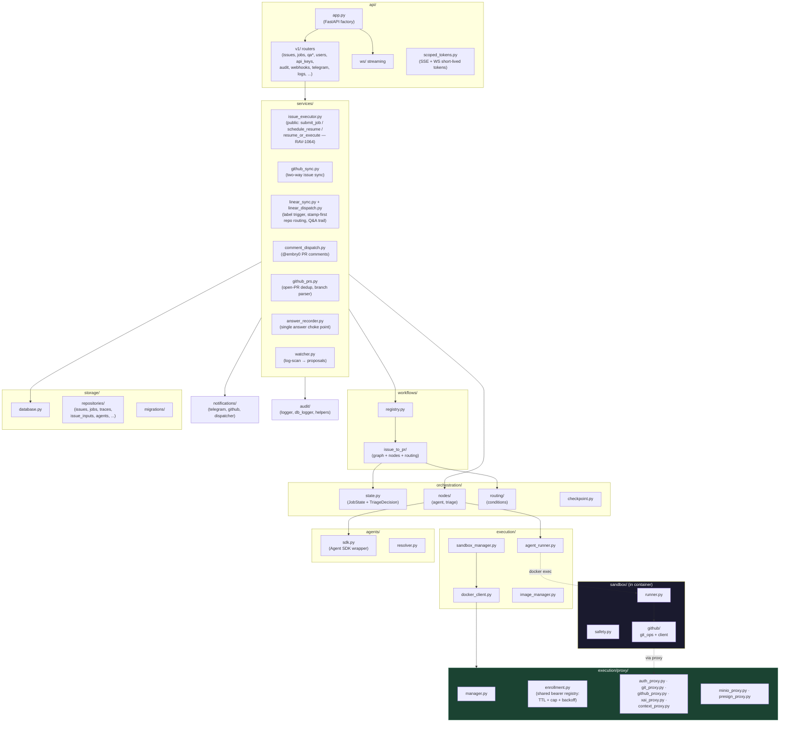

---

## External Integrations

### Cloudflare Tunnels (production ingress)

Two tunnels with disjoint jobs:

**Webhooks tunnel** — restricted to webhook paths only:

| Path | Service | Purpose |
|------|---------|---------|
| `/api/v1/webhook` | GitHub webhook | Issue events, PR events, comments |
| `/api/v1/webhook/linear` | Linear webhook | Label-trigger dispatch (EMB-47); repo from the project's `repo:` stamp, `LINEAR_REPO_MAP` fallback (RAV-1397) |
| `/api/v1/webhook/gitlab` | GitLab webhook | Issue Hook label-trigger dispatch (#165); `X-Gitlab-Token` shared-secret auth |
| `/api/v1/telegram/callback` | Telegram Bot API | Reply-to-message answers |
| Everything else | **Blocked** | Not routed by this tunnel |

**Dashboard tunnel** (`cloudflared-dashboard` compose service, RAV-1069) — fronts the full dashboard publicly behind Auth0 SSO (server-side OIDC; the login form is SSO-only on the public origin, Bearer-header API auth works everywhere). nginx on the public vhost 404s the webhook/telegram/internal paths so the two ingress surfaces never overlap, and sends CSP and HSTS. That vhost exists only when `DASHBOARD_PUBLIC_HOSTNAME` (in `infra/.env`) names the public hostname; unset, every Host gets the LAN vhost. The tunnel's ingress is rendered from the same variable by the one-shot `cloudflared-dashboard-config` service, and the tunnel does not start without a valid one. See [sso.md](sso.md#ingress).

Verification is always on in production, but **each forge authenticates differently** (all three shapes handled by the shared ingress, `embry0/api/webhook_ingress.py`): GitHub sends a `sha256=`-prefixed HMAC-SHA256 in `X-Hub-Signature-256`, Linear a **bare hex** HMAC-SHA256 in `Linear-Signature`, and GitLab the shared secret **verbatim in plaintext** in `X-Gitlab-Token`. See [webhooks.md](webhooks.md) for setup per forge.

### smee.io Relay (local development webhook ingress)

For developer laptops without a public URL, embry0 supports the [smee.io](https://smee.io) relay pattern. The GitHub webhook is pointed at a smee channel URL, and `smee-client` forwards received events to `http://localhost:8200/api/v1/webhook`. Because smee re-serializes the JSON payload before forwarding, GitHub's HMAC signature is invalidated — so this flow requires `WEBHOOK_DEV_MODE=true` and an empty `GITHUB_WEBHOOK_SECRET`. `WEBHOOK_DEV_MODE` leaves API authentication on, so `API_KEY` must still be set. (`AUTH_DEV_MODE` is the unrelated separate flag for bypassing API key auth; do NOT enable it just for the webhook flow.) Startup refuses either flag while SSO is configured or the root `.env` carries a tunnel token.

The handler in `embry0/api/v1/webhooks.py` supports this flow in two ways:

1. `verify_webhook_signature(..., webhook_dev_mode=True)` skips HMAC verification when no secret is configured.
2. After JSON parsing, the handler detects and unwraps smee's `{"payload": "<json-string>"}` envelope so downstream code sees the real GitHub payload unchanged.

The same relay flow works for the Linear and GitLab endpoints — `WEBHOOK_DEV_MODE=true` applies one dev-mode policy across all three routes.

See [webhooks.md](webhooks.md#option-b--smeeio-relay-local-development) for the end-to-end setup. **Never enable this configuration in production** — any unsigned `POST` to `/api/v1/webhook` will be accepted and could trigger jobs.

### Telegram Bot

- Webhook registered on app startup via `setWebhook` API
- Secret token verification via `X-Telegram-Bot-Api-Secret-Token` header
- Per-question messages with inline "Answer in Dashboard" buttons
- Reply-to-message matching for free-text answers

---

## Future: Spring Boot SaaS Layer

Spring Boot manages a fleet of embry0 instances — one per tenant. embry0 remains single-tenant internally.

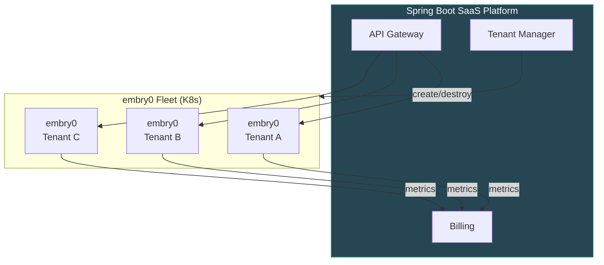
